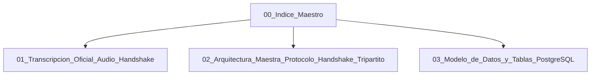

# 🤝 HANDSHAKE PETRAL - AGENCIA MARÍTIMA - NAVITRANSO (SAP)
## Módulo Etapa 2: Liquidación de Gastos Portuarios y Consenso Pre-Facturación

> **Bóveda Oficial:** `HANDSHAKE.PETRAL.AG.MARIT.NAVITRANSO`  
> **Ubicación Local:** `C:\Users\rguti\PETRAL.SMART.DASHBOARD\Desarrollo.Profesional\HANDSHAKE.PETRAL.AG.MARIT.NAVITRANSO`  
> **Plataforma:** PETRAL ONE (`SHIPPING.SOFT ENTERPRISE`)  
> **Fecha de Creación:** 23 de Octubre de 2026  
> **Estado:** 🚀 Fase de Diseño y Especificación Técnica  

---

## 📌 Propósito Estratégico

Resolver el problema estructural de pagos tardíos a las agencias marítimas y fricción administrativa mediante un **mecanismo de consenso previo (Handshake)** entre **Sandra Gálvez (Petral)** y la **Agencia Marítima**, basado en los datos reales del **Libro de Hechos (SOF)** y el motor determinístico de PETRAL ONE, culminando en la entrega limpia del paquete digital a **Navitranso (SAP)**.

---

## 🗺️ Mapa de Documentos de la Bóveda

| # | Documento | Descripción |
|---|---|---|
| **01** | [`01_Transcripcion_Oficial_Audio_Handshake.md`](01_Transcripcion_Oficial_Audio_Handshake.md) | Transcripción textual fiel con OpenAI Whisper del audio del usuario, desglose del dolor operativo y visión de la solución. |
| **02** | [`02_Arquitectura_Maestra_Protocolo_Handshake_Tripartito.md`](02_Arquitectura_Maestra_Protocolo_Handshake_Tripartito.md) | Matriz de actores, diagrama de estados de la escala portuaria, componentes FastAPI y UI en React 19. |
| **03** | [`03_Modelo_de_Datos_y_Tablas_PostgreSQL.md`](03_Modelo_de_Datos_y_Tablas_PostgreSQL.md) | Diagrama Entidad-Relación y script DDL completo para PostgreSQL (`petral_db`). |

---

## 👥 Actores y Flujo Tripartito

1. **PETRAL (Sandra Gálvez):** Audita movimientos del barco, valida la proforma calculada por el motor y lidera el consenso.
2. **AGENCIAS MARÍTIMAS (2 Agencias):** Acceden a conciliar rubro por rubro antes de emitir la factura, erradicando las notas de crédito.
3. **NAVITRANSO (Backoffice / SAP):** Recibe el expediente cerrado y validado para su contabilización sin demoras.
