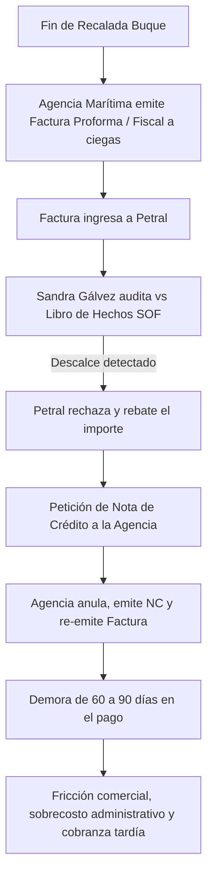
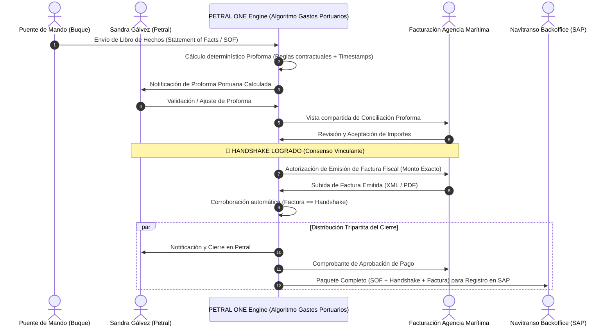

# 🎙️ Transcripción Oficial y Ficha de Especificación Estratégica: Protocolo Handshake de Liquidaciones Portuarias

> **Bóveda:** `HANDSHAKE.PETRAL.AG.MARIT.NAVITRANSO`  
> **Archivo Fuente de Audio:** `C:\Users\rguti\PETRAL.SMART.DASHBOARD\audio_transcrip\HAND.SHAKE.LIQUIDACIONES.AG.MARITIMA.ogg`  
> **Motor de Transcripción:** OpenAI Whisper (`base` model - FP32 CPU)  
> **Fecha de Emisión:** 23 de Octubre de 2026  
> **Stakeholders Clave:**  
> - **PETRAL S.A.C.:** Sandra Gálvez (Supervisora Comercial / Experta de Costos Portuarios)  
> - **Agencias Marítimas:** Operadores y responsables de facturación en muelle (2 agencias activas)  
> - **NAVITRANSO S.A.:** Socio accionista al 50% de Petral, encargado del Backoffice y ERP SAP  

---

## 1. 📜 Transcripción Fiel del Audio

> *"Feminis, tú sabes que se viene una etapa 2 del sistema, la etapa 2 es la liquidación de los gastos portuarios, entonces lo que estábamos planteando es que nosotros tengamos nuestros algoritmos de los costos reales en los puertos y con eso comparemos contra lo que viene como facturación de gastos portuarios, pero el user me habla de un gran problema que existe, ahora los las agencias marítimas siempre son pagadas tarde, ¿cuál es la razón? la razón es que se liquida prácticamente cuando ya tienen las facturas emitidas, entonces ellos emiten las facturas e internamente ante esa factura, Sandra Gálvez de Petral, que es la experta, en su mayoría de veces rebate el monto de la factura y hay que pedirles una nota de crédito, facturar de nuevo y esto genera mucha molestia, porque los agencias marítimas cobran en doble o triple del periodo que deberían cobrar, entonces esta es la idea, vamos a plantear un flujo que funcione de la siguiente manera, vamos a hacer una extensión de Petral One que sea accesible, es un módulo que sea solamente accesible, obviamente a Sandra a Petral, pero también sea accesible a las dos agencias de aduana que se tiene, entonces en este módulo vamos a una vez terminado el servicio, es decir, no, la carga o la descarga, este módulo lo que haría es hacer una liquidación de acuerdo a lo que recibimos de información del puente de mando del barco, o sea, los movimientos del barco, el libro de hechos que dicen, entonces de acuerdo a todas las reglas contractuales, esto sabiendo exactamente la obra fecha que ha entrado el barco y las reglas contractuales, sería capaz de decir los gastos portuarios correspondientes a este viaje o carguer es carga, son tantos y eso sería compartido con las agencias marítimas, entonces antes de que ellos facturen, se debería lograr un handshake, un consenso sobre esos gastos portuarios por ambas partes, por Sandra Gálvez en representación de Petral y por quien sea la persona que esté en facturación de este como sea la agencia marítima, entonces con eso que lograríamos, una vez que hay el handshake en ese brazo del sistema, entonces ya se les permite facturar esa factura queda, digamos, corroborada por la liquidación que se había acordado y luego enviamos a las tres partes el acuerdo, que sería una parte de a Petral, otra parte a la propia agencia y otra parte a Navitranso, y por qué tiene que intervenir Navitranso, porque Navitranso es quien le hace el backoffice a Petral, porque es su 50% de dueño de Petral y tiene un SAP, entonces ese es el proyecto."*

---

## 2. 🔍 Desglose Pericial del Problema Operativo Actual (Escena del Crimen As-Is)

### Principales Dolores (Pain Points):
1. **Cobranza Tardía de las Agencias:** Las agencias marítimas perciben sus cobros en el doble o triple del plazo contractual habitual (60-90 días en lugar de 30).
2. **Ciclo Destructivo de Notas de Crédito:** Gran porcentaje de facturas emitidas son observadas por Petral, exigiendo emisión de notas de crédito y refacturación.
3. **Auditoría Reactiva vs Proactiva:** La auditoría de Petral se ejecuta *post-facturación*, cuando la fricción tributaria y contable ya es irreversible.
4. **Desconexión con Navitranso (SAP):** Navitranso, como socio al 50% y operador del backoffice contable/SAP, recibe facturas con demoras y enmiendas, perjudicando el cierre contable de los viajes.

---

## 3. 🎯 Visión de la Solución: Módulo Handshake Tripartito en PETRAL ONE (To-Be)

---

## 4. 🧩 Pilares Técnicos de la Etapa 2

1. **Ingesta del Libro de Hechos (*Statement of Facts* / SOF):**
   * Registro estructurado de eventos de muelle: arribo a fondeadero, prácticos (in/out), remolcadores (in/out), amarre, inicio/fin de carga o descarga, desatraque y zarpe.
2. **Motor de Reglas y Algoritmos de Costos Portuarios Reales:**
   * Tarifas oficiales de APM Terminals, DP World, Tisur, Enapu y puertos privados según GRT, eslora, tiempos de muelle y servicios complementarios.
3. **Portal Colaborativo Ligero para Agencias:**
   * Acceso securizado con token/rol para las 2 agencias marítimas habituales de Petral.
   * Vista comparativa de rubros: Remolque, Prácticos, Muellaje, Uso de Muelle, Servicios a la Nave.
4. **Token de Aprobación Criptográfico (Handshake Log):**
   * Hash único inmutable que certifica que ambas partes aprobaron los montos antes de emitir la factura.
5. **Enlace a Navitranso Backoffice (SAP Ready):**
   * Exportación de layout estándar pre-contable para inyección en el ERP SAP de Navitranso sin reprocesos.
