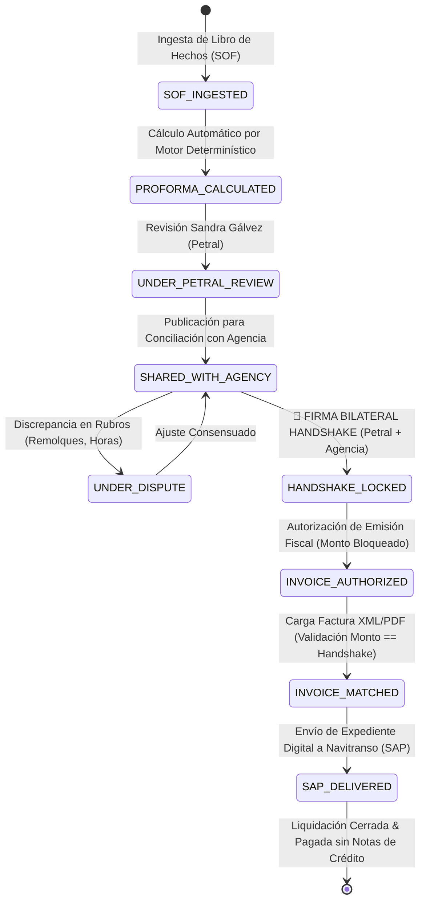

# 🏛️ Arquitectura Maestra: Protocolo Handshake Tripartito de Liquidaciones Portuarias

> **Sistema:** PETRAL ONE (`SHIPPING.SOFT ENTERPRISE`) — Extensión Módulo Etapa 2  
> **Bóveda:** `HANDSHAKE.PETRAL.AG.MARIT.NAVITRANSO`  
> **Servidor:** VPS Oficial Contabo (`169.58.168.107` / `https://petral.one.geeksoft.tech`)  
> **Fecha:** 23 de Octubre de 2026  
> **Estado:** 📋 Especificación Arquitectónica  

---

## 1. 👥 Matriz de Roles y Actores del Protocolo

| Actor / Rol | Institución | Responsabilidades Clave | Acceso en PETRAL ONE |
|---|---|---|---|
| **Supervisora de Costos Portuarios** | **PETRAL S.A.C.** (Sandra Gálvez) | Carga del Libro de Hechos (SOF), validación de proforma calculada por el motor, negociación de discrepancias y firma del Handshake por parte del Armador / Operador. | Acceso completo de edición y autorización en `/port-liquidations/handshake`. |
| **Facturación de Agencia Marítima** | **Agencias Marítimas (2 Agencias)** | Inspección de la proforma liquidada, propuesta de ajustes con sustento operativo, conformidad con el monto final y carga de Factura Electrónica aprobada (XML/PDF). | Portal externo restringido con enlace seguro / login multi-tenant para ver solo las recaladas de su agencia. |
| **Backoffice Contable / ERP SAP** | **NAVITRANSO S.A.** (Accionista 50%) | Recepción del expediente digital consensuado (SOF + Liquidación Handshake + Factura corroborada) para ingreso directo al ERP SAP y programación puntual de pago. | Vista de consulta, reportes ejecutivos y exportación de paquetes contables SAP (`.json` / `.xlsx`). |

---

## 2. 🔄 Diagrama de Estados de la Recalada (Port Call Lifecycle)

---

## 3. 🧩 Componentes del Ecosistema

### 3.1 Backend (FastAPI Engine en `backend/api/routers/port_handshake.py`)
1. **Ingestor de Tiempos y Movimientos de Muelle (`/api/v1/port-handshake/sof/upload`):**
   * Parser o formulario estructurado de eventos del puente de mando (fechas/horas precisas de fondeo, prácticos, remolcadores, atraque, inicio/fin carga-descarga, desamarre).
2. **Motor de Cálculo Portuario Proforma (`/api/v1/port-handshake/calculate`):**
   * Aplica la matriz de costos y reglas por terminal y buque (`vessel_terminal_operations`, `port_costs_matrix`, `port_cost_static`).
3. **Mecanismo de Bloqueo de Handshake (`/api/v1/port-handshake/{id}/lock`):**
   * Generación de UUID y Hash SHA-256 inmutable de la proforma aprobada por Sandra Gálvez y la Agencia.
4. **Validador de Factura vs Handshake (`/api/v1/port-handshake/{id}/match-invoice`):**
   * Compara el subtotal y total del comprobante cargado contra el monto del Handshake (Tolerancia: $0.00). Si coincide, cambia a estado `INVOICE_MATCHED`.
5. **Generador de Paquete Navitranso SAP (`/api/v1/port-handshake/{id}/sap-package`):**
   * Consolida la carátula contable, desgloses por centro de costo de buque y documentos de sustento.

### 3.2 Frontend (React 19 + TypeScript + Tailwind)
1. **Página Principal de Liquidaciones Handshake:** `/port-liquidations`
2. **Tablero Split-Screen de Conciliación:**
   * Panel Izquierdo: Movimientos del barco (Libro de Hechos / SOF auditado).
   * Panel Central: Grilla de liquidación con desglose de conceptos (Uso muelle, Prácticos, Remolcadores, Muellaje, Servicios).
   * Panel Derecho: Chat de observaciones y botón de **"Firmar Handshake"**.
3. **Portal Seguro de Agencia:** Interfaz limpia con vista de solo lectura del cálculo y aceptación formal del importe.
4. **Visor de Estado Tripartito:** Indicador visual de qué partes ya firmaron (Petral: ✅ | Agencia: ✅ | Navitranso: ⏳).
