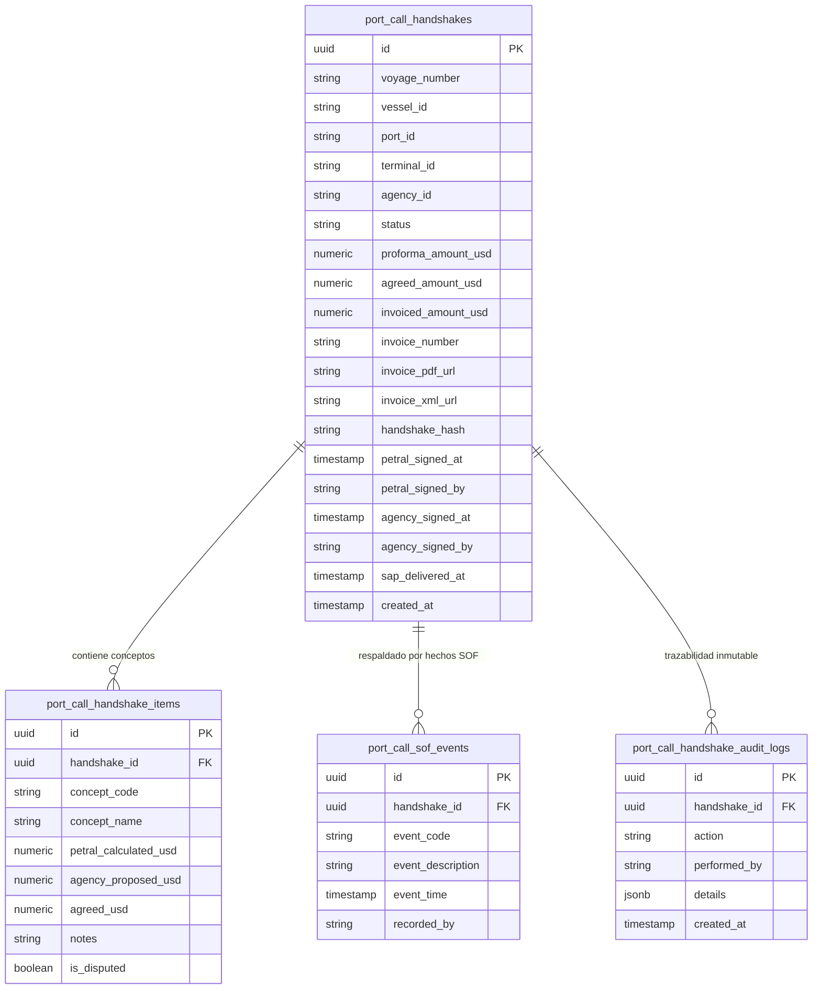

# 🗄️ Modelo de Datos y Esquema PostgreSQL: Protocolo Handshake

> **Bóveda:** `HANDSHAKE.PETRAL.AG.MARIT.NAVITRANSO`  
> **Motor:** PostgreSQL Producción Contabo (`10.0.1.16:5432/petral_db`)  
> **Fecha:** 23 de Octubre de 2026  

---

## 1. 📐 Diagrama Entidad-Relación (E-R)



---

## 2. 📜 Script DDL PostgreSQL Oficial

```sql
-- 1. Cabecera Principal de Liquidación Handshake
CREATE TABLE IF NOT EXISTS port_call_handshakes (
    id UUID PRIMARY KEY DEFAULT gen_random_uuid(),
    voyage_number VARCHAR(100) NOT NULL,
    vessel_id VARCHAR(50) NOT NULL,
    port_id VARCHAR(50) NOT NULL,
    terminal_id VARCHAR(50) NOT NULL,
    agency_id VARCHAR(100) NOT NULL,            -- Identificador de la Agencia Marítima
    operation_type VARCHAR(20) DEFAULT 'CARGA',  -- 'CARGA', 'DESCARGA', 'FONDEO'
    status VARCHAR(50) DEFAULT 'PROFORMA_CALCULATED',
    
    -- Montos Clave
    proforma_amount_usd NUMERIC(14, 2) DEFAULT 0.00,
    agreed_amount_usd NUMERIC(14, 2) DEFAULT 0.00,
    invoiced_amount_usd NUMERIC(14, 2) DEFAULT 0.00,
    currency VARCHAR(10) DEFAULT 'USD',
    
    -- Datos de Factura Fiscal
    invoice_number VARCHAR(100),
    invoice_pdf_url TEXT,
    invoice_xml_url TEXT,
    invoice_uploaded_at TIMESTAMP WITH TIME ZONE,
    
    -- Consenso y Cierre Bilateral (Handshake)
    handshake_hash VARCHAR(128),
    petral_signed_at TIMESTAMP WITH TIME ZONE,
    petral_signed_by VARCHAR(150),              -- Sandra Gálvez
    agency_signed_at TIMESTAMP WITH TIME ZONE,
    agency_signed_by VARCHAR(150),              -- Contacto Facturación Agencia
    
    -- Cierre Backoffice Navitranso (SAP)
    sap_delivered_at TIMESTAMP WITH TIME ZONE,
    sap_doc_entry VARCHAR(100),
    sap_batch_id VARCHAR(100),
    
    created_at TIMESTAMP WITH TIME ZONE DEFAULT NOW(),
    updated_at TIMESTAMP WITH TIME ZONE DEFAULT NOW()
);

-- Índices de consulta rápida
CREATE INDEX IF NOT EXISTS idx_handshake_voyage ON port_call_handshakes(voyage_number);
CREATE INDEX IF NOT EXISTS idx_handshake_vessel ON port_call_handshakes(vessel_id);
CREATE INDEX IF NOT EXISTS idx_handshake_status ON port_call_handshakes(status);
CREATE INDEX IF NOT EXISTS idx_handshake_agency ON port_call_handshakes(agency_id);

-- 2. Detalle de Conceptos Liquidables (Partida x Partida)
CREATE TABLE IF NOT EXISTS port_call_handshake_items (
    id UUID PRIMARY KEY DEFAULT gen_random_uuid(),
    handshake_id UUID NOT NULL REFERENCES port_call_handshakes(id) ON DELETE CASCADE,
    concept_code VARCHAR(50) NOT NULL,          -- 'TUG_IN', 'PILOT_IN', 'BERTH_DUE', 'WHARFAGE', etc.
    concept_name VARCHAR(150) NOT NULL,
    petral_calculated_usd NUMERIC(14, 2) DEFAULT 0.00,
    agency_proposed_usd NUMERIC(14, 2) DEFAULT 0.00,
    agreed_usd NUMERIC(14, 2) DEFAULT 0.00,
    is_disputed BOOLEAN DEFAULT FALSE,
    notes TEXT,
    created_at TIMESTAMP WITH TIME ZONE DEFAULT NOW()
);

CREATE INDEX IF NOT EXISTS idx_handshake_items_hid ON port_call_handshake_items(handshake_id);

-- 3. Eventos del Libro de Hechos (Statement of Facts / SOF)
CREATE TABLE IF NOT EXISTS port_call_sof_events (
    id UUID PRIMARY KEY DEFAULT gen_random_uuid(),
    handshake_id UUID NOT NULL REFERENCES port_call_handshakes(id) ON DELETE CASCADE,
    event_code VARCHAR(50) NOT NULL,          -- 'EOSP', 'POB_IN', 'FIRST_LINE', 'ALL_FAST', 'COMMENCE_LOAD', etc.
    event_description VARCHAR(255) NOT NULL,
    event_time TIMESTAMP WITH TIME ZONE NOT NULL,
    recorded_by VARCHAR(100) DEFAULT 'Puente de Mando',
    created_at TIMESTAMP WITH TIME ZONE DEFAULT NOW()
);

CREATE INDEX IF NOT EXISTS idx_handshake_sof_hid ON port_call_sof_events(handshake_id);

-- 4. Pistas de Auditoría Inmutable (Ledger de Acciones)
CREATE TABLE IF NOT EXISTS port_call_handshake_audit_logs (
    id UUID PRIMARY KEY DEFAULT gen_random_uuid(),
    handshake_id UUID NOT NULL REFERENCES port_call_handshakes(id) ON DELETE CASCADE,
    action VARCHAR(100) NOT NULL,             -- 'PROFORMA_GENERATED', 'DISPUTE_RAISED', 'HANDSHAKE_SIGNED', 'INVOICE_MATCHED'
    performed_by VARCHAR(150) NOT NULL,
    details JSONB DEFAULT '{}'::jsonb,
    created_at TIMESTAMP WITH TIME ZONE DEFAULT NOW()
);

CREATE INDEX IF NOT EXISTS idx_handshake_audit_hid ON port_call_handshake_audit_logs(handshake_id);
```
