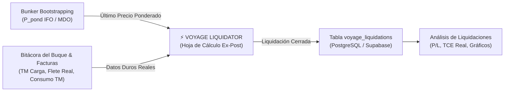

# 52 - Plan Maestro y Especificación Técnica: Voyage Liquidator (Liquidación Real Ex-Post)

> **Documento:** `52_Voyage_Liquidator.md`  
> **Ubicación:** `Desarrollo.Profesional/Obsidian.Refactorizacion.Multicotizador/`  
> **Fecha:** 16 de Octubre de 2026  
> **Módulo:** Herramientas de Análisis y Proyección Comercial • PETRAL ONE  
> **Dependencias Directas:** `Bunker Bootstrapping` (`/bunker-bootstrapping`), `Spaghetti Map` (`/spaghetti-map`), `Análisis de Liquidaciones` (`/liquidations-graphic-analysis`), `MultiCotizador / Voyage Calculator` (`/multicotizador`)  
> **Estado:** Especificación y Plan Operativo Aprobado

---

## 1. 🎙️ Transcripción Pericial del Audio de Gerencia (`VOYAGE_Liquodator.ogg`)

Procesado y transcrito mediante motor Whisper (`transcribe_whisper.py`):

```text
"Feminía ahora que está terminado de bunker bootstrapping, vamos a hacer otro herramiento, esta herramienta va a estar después de spaghetti map y antes de análisis de liquidaciones, se va a llamar voyas liquidator y la idea es que sea un input para que se liquide en los viajes realmente, con datos duros, es decir, es una hoja de cálculo que sigue la misma lógica que la hoja de cálculo voy a escalculator, pero en vez de hacer cálculos sofisticados simplemente toma números agregados, es decir, vamos a tener que tomar las tonelas reales, el flete real, el bunker real, o sea, no calcular el bunker, sino cuántas tonelas de bunker consumió, va a tener que jalar el precio del último bunker, del último buque, si me entiendes, no, eso sabremos cuántas toneladas consumió, pero el precio lo determina el último promedio que está en bunker bootstrapping, entiendes, entonces va a ser muy similar, partamos con la idea de que va a ser prácticamente igual a voy a escalculator y vamos modificándolo, paso a paso, ok, entonces hagamos una nueva notemdipareza."
```

---

## 2. 🎯 Propósito Estratégico y Esencia de Negocio

El ecosistema PETRAL ONE contaba hasta ahora con dos extremos:
1. **Voyage Calculator (`/multicotizador`):** Un simulador predictivo **Ex-Ante**. Estima distancias teóricas entre puertos, velocidades de crucero, días de mar y puerto, y consumos teóricos de combustible para cotizar y proyectar rutas comerciales.
2. **Análisis de Liquidaciones (`/liquidations-graphic-analysis`):** Un visor analítico de inteligencia y gráficos que explota los registros históricos de viajes ya ejecutados y liquidados (`voyage_liquidations`).

**Faltaba el eslabón intermedio:** la herramienta de **Liquidación Operativa Real Ex-Post**.

**`Voyage Liquidator`** se concibe como la interfaz de **captura, cálculo y liquidación fáctica con datos duros de bitácora y facturación**. No realiza proyecciones ni simulaciones de navegación; toma los datos ejecutados del viaje (toneladas cargadas, flete facturado, días reales y consumo físico de búnker) y los cruza automáticamente con la contabilidad ponderada de combustible de **Bunker Bootstrapping**, generando la liquidación económica oficial del viaje.



---

## 3. 🗺️ Navegación y Ubicación en la Suite PETRAL ONE

En estricto cumplimiento de la directiva de gerencia, **`Voyage Liquidator`** se posiciona en el menú lateral de **`🛠️ HERRAMIENTAS`**, ubicándose exactamente entre **`Spaghetti Map`** y **`Análisis Liquidaciones`**:

```text
🛠️ HERRAMIENTAS
  ├── ⛴️ Voyage Calculator           (/multicotizador)
  ├── 📊 Matriz Financiera           (/dashboard)
  ├── 📈 Análisis Gráfico            (/graphic-analysis)
  ├── 🗺️ Spaghetti Map              (/spaghetti-map)
  ├── ⚖️ Voyage Liquidator           (/voyage-liquidator)   <--- [NUEVA HERRAMIENTA]
  └── 📊 Análisis Liquidaciones      (/liquidations-graphic-analysis)
```

### Rutas e Identificadores Técnicos:
* **Ruta Frontend:** `/voyage-liquidator`
* **Tab ID en Layout:** `'voyage-liquidator'`
* **Permiso en RBAC:** `hasPermission('liquidaciones_viajes', 'Visor' | 'Editor')` (o integrado al grupo de liquidaciones).

---

## 4. ⚖️ Cuadro Comparativo: Voyage Calculator vs. Voyage Liquidator

| Dimensión | Voyage Calculator (`/multicotizador`) | Voyage Liquidator (`/voyage-liquidator`) |
| :--- | :--- | :--- |
| **Naturaleza** | **Ex-Ante (Proyección / Cotización)** | **Ex-Post (Liquidación Real Fáctica)** |
| **Carga / Tonelaje** | Capacidad estimada / Nominación contractual | **Toneladas reales medidas en BL / Recibo de carga** |
| **Flete** | Tarifa spot calculada o contractual estimada | **Tarifa real facturada ($/TM o Lumpsum)** |
| **Días de Viaje** | Distancia millas / Velocidad kts + Días de maniobra | **Días reales cronometrados entre zarpe y recalada** |
| **Consumo de Bunker** | Fórmula teórica: $(Días_{mar} \times Cons_{mar}) + (Días_{pto} \times Cons_{pto})$ | **Dato duro de bitácora:** Toneladas reales consumidas de IFO y MDO según sondería |
| **Precio del Bunker** | Input manual o cotización spot de mercado | **Automático:** Último $P_{pond}$ registrado en `Bunker Bootstrapping` para esa nave a la fecha |
| **Gastos Portuarios** | Tarifa estática de catálogo / Proforma de agencia | **Gastos reales liquidados por la agencia marítima** |
| **Output Principal** | Cotización sugerida y rentabilidad proyectada | **P&L real del viaje, TCE real ($/día) y persistencia en `voyage_liquidations`** |

---

## 5. 🧮 Motor Matemático de Voyage Liquidator

### 5.1 Fórmulas Clave de Liquidación:

1. **Ingreso Bruto de Flete ($Gross\ Revenue$):**
   $$Gross\ Revenue = Carga\ Real\ (TM) \times Flete\ Real\ (\$/TM) \quad [\text{o Lumpsum}]$$

2. **Costo Real de Combustible ($Bunker\ Cost$):**
   El precio unitario no es un input libre ni una suposición. Se obtiene del último evento cronológico del buque en `bunker_bunkering_events` previo o coincidente con la fecha del viaje:
   $$P_{IFO} = P_{pond}^{IFO}\ (\text{de Bunker Bootstrapping})$$
   $$P_{MDO} = P_{pond}^{MDO}\ (\text{de Bunker Bootstrapping})$$
   $$Bunker\ Cost = (Consumo\ Real\ IFO_{TM} \times P_{IFO}) + (Consumo\ Real\ MDO_{TM} \times P_{MDO})$$

3. **Gastos de Escala y Puerto ($Port\ Expenses$):**
   $$Port\ Expenses = \sum Gastos\ Reales\ de\ Agencia\ en\ Puertos\ de\ Carga\ y\ Descarga$$

4. **Net Voyage Revenue (NVR):**
   $$NVR = Gross\ Revenue - Bunker\ Cost - Port\ Expenses - Otros\ Gastos\ Directos$$

5. **Utilidad Neta del Viaje ($Net\ Profit$):**
   $$Net\ Profit = NVR - (Días\ Reales \times Hire/Opex\ Diario)$$

6. **Time Charter Equivalent Real ($TCE\ Real\ \$/día$):**
   $$TCE\ Real = \frac{NVR}{Días\ Reales\ de\ Viaje}$$

---

## 6. 🖥️ Diseño Visual y Experiencia de Usuario (UI/UX)

La herramienta adopta la **estética de hoja de cálculo minimalista corporativa de PETRAL ONE** (basada en `MultiCotizadorExcel`, pero sin las columnas predictivas que no aplican):

```
┌────────────────────────────────────────────────────────────────────────────────────────────────────────────────────────┐
│ ⚖️ VOYAGE LIQUIDATOR • Hoja de Liquidación de Viajes Reales                                                           │
│ Filtros: [Buque: B/T MOQUEGUA ▼] [Período: 2026-10 ▼] [Cliente: TODOS ▼]                   [+ Liquidar Nuevo Viaje]    │
├────────────────────────────────────────────────────────────────────────────────────────────────────────────────────────┤
│ ESTADO DE VINCULACIÓN CON BUNKER BOOTSTRAPPING (B/T MOQUEGUA):                                                         │
│ ⚓ Último Evento: TNK-20261015-CALLAO • P_pond IFO: $911.90/TM • P_pond MDO: $1,571.65/TM • BAF: -0.1380 USD/pmt  🔒 Enlazado│
├────────────────────────────────────────────────────────────────────────────────────────────────────────────────────────┤
│ VIAJE | FECHA    | CLIENTE | RUTA (POL ➔ POD) | CARGA REAL | FLETE REAL | IFO CONS | MDO CONS | BUNKER USD | DISB. USD | DÍAS | TCE REAL/DÍA | UTILIDAD NET  │
├───────┼──────────┼─────────┼──────────────────┼────────────┼────────────┼──────────┼──────────┼────────────┼───────────┼──────┼──────────────┼───────────────┤
│ V.761 │ 01/10/26 │ SPCC    │ ILO ➔ MATARANI   │ 10,252 TM  │ $19.23/TM  │ 12.0 TM  │ 1.5 TM   │ $13,299    │ $51,598   │ 3.2d │ $41,250/día  │ +$91,420 USD  │
│ V.762 │ 08/10/26 │ SPCC    │ ILO ➔ MARCONA    │ 12,502 TM  │ $22.23/TM  │ 26.5 TM  │ 2.8 TM   │ $28,565    │ $49,676   │ 5.8d │ $34,430/día  │ +$124,310 USD │
│ V.763 │ 15/10/26 │ NEXA    │ CALLAO ➔ MARCONA │ 13,500 TM  │ $24.50/TM  │ 42.0 TM  │ 5.5 TM   │ $46,943    │ $47,520   │ 7.2d │ $32,810/día  │ +$142,500 USD │
└────────────────────────────────────────────────────────────────────────────────────────────────────────────────────────┘
```

### Componentes de la Interfaz:
1. **Barra Superior de Selección:** Selector de Buque (`MOQUEGUA`, `TABLONES`, `HUEMUL`, `CONCON`), selector de año/mes y botón `[+ Liquidar Nuevo Viaje]`.
2. **Badge de Vinculación Búnker en Caliente:** Muestra el último precio ponderado registrado para la nave seleccionada en `Bunker Bootstrapping`, garantizando que el usuario verifique la base de costeo del combustible antes de liquidar.
3. **Grilla / Spreadsheet Editable:**
   * Celdas de entrada directa (datos duros): Toneladas de carga, Flete pactado, Toneladas IFO consumidas, Toneladas MDO consumidas, Gastos de puerto reales, Días reales.
   * Celdas calculadas automáticamente: Costo de Búnker, Ingreso Bruto, TCE Real, Utilidad Neta, Margen %.
4. **Modal / Drawer de Detalle de Liquidación:**
   * Desglose pormenorizado del cálculo.
   * Visualización del comprobante / bitácora de viaje.
   * Botón `[Guardar en Base de Datos Oficial]` para impactar `voyage_liquidations`.

---

## 7. 🗄️ Esquema de Base de Datos y Persistencia

La liquidación se consolida en la tabla oficial existente `voyage_liquidations`:

```sql
-- Estructura de persistencia en PostgreSQL / Supabase
-- Tabla: voyage_liquidations
-- Columnas principales:
-- - id (UUID, PK)
-- - voyage_code (VARCHAR, UNIQUE, ej. 'V.763')
-- - vessel_name (VARCHAR)
-- - client_name (VARCHAR)
-- - voyage_date (DATE)
-- - pol_port (VARCHAR)
-- - pod_port (VARCHAR)
-- - cargo_quantity_mt (NUMERIC)
-- - freight_rate_usd (NUMERIC)
-- - gross_revenue_usd (NUMERIC)
-- - tce_usd_day (NUMERIC)
-- - net_profit_usd (NUMERIC)
-- - details (JSONB):
--     {
--       "bunker_consumption": {
--         "ifo_mt": 42.0,
--         "mdo_mt": 5.5,
--         "ifo_price_usd": 911.90,
--         "mdo_price_usd": 1571.65,
--         "total_bunker_usd": 46943.88,
--         "bunker_event_id": "affd6797-adb0-4c8d-943c-3beddf4d30f4"
--       },
--       "port_expenses": { "total_agency_usd": 47520.00 },
--       "voyage_days": 7.2
--     }
```

---

## 8. 🚀 Plan de Ejecución Quirúrgica Paso a Paso (Roadmap)

Siguiendo el mandato de gerencia (*"partamos con la idea de que va a ser prácticamente igual a voy a escalculator y vamos modificándolo, paso a paso"*):

### **Paso 1: Routing & Estructura Base de Navegación**
* Registrar la ruta `/voyage-liquidator` en `App_V2.tsx`.
* Añadir el botón `Voyage Liquidator` en `MasterTemplate_V2.tsx` entre `Spaghetti Map` y `Análisis Liquidaciones`.
* Actualizar `ToolsLayout_V2.tsx` para reconocer el `activeTab = 'voyage-liquidator'`.

### **Paso 2: Componente Base `VoyageLiquidator_V2.tsx`**
* Clonar la estructura de layout y spreadsheet de `MultiCotizadorExcel.tsx`, depurando las columnas predictivas de navegación teórica (millas, velocidades de catálogo, etc.).
* Crear la vista ejecutiva con filtros de nave y grilla de datos agregados reales.

### **Paso 3: Integración con Bunker Bootstrapping API**
* Conectar con el endpoint `GET /api/v1/bunker-bootstrapping/events/{vessel_id}` para recuperar el último `$P_{pond}^{IFO}$` y `$P_{pond}^{MDO}$` activo de la nave.
* Mostrar el badge de auditoría de combustible en el encabezado.

### **Paso 4: Lógica de Liquidación Fáctica en Caliente**
* Implementar los inputs de datos duros:
  * Toneladas reales de carga y flete.
  * Consumo real en TM de IFO y MDO.
  * Costos portuarios reales y duración en días.
* Recalcular en tiempo real el costo total de búnker, TCE real ($/día) y utilidad neta.

### **Paso 5: Persistencia y Verificación en Vivo en Contabo VPS**
* Conectar con el endpoint `POST /api/v1/forecast/voyage_liquidations` para guardar o actualizar liquidaciones auditadas.
* Compilar con `npx vite build` y desplegar a producción en `https://petral.one.geeksoft.tech`.
