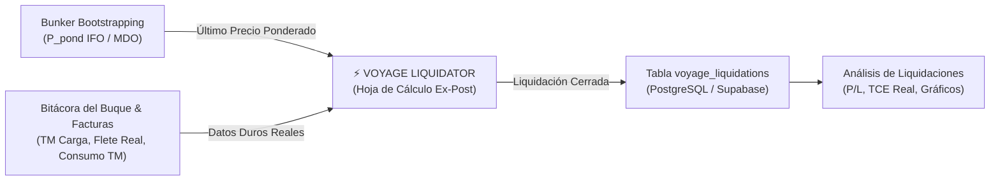

# 52 - Plan Maestro y Especificación Técnica: Voyage Liquidator (Liquidación Real Ex-Post)

> **Documento:** `52_Voyage_Liquidator.md`  
> **Ubicación:** `Desarrollo.Profesional/Obsidian.Refactorizacion.Multicotizador/`  
> **Fecha:** 16 de Octubre de 2026  
> **Módulo:** Herramientas de Análisis y Proyección Comercial • PETRAL ONE  
> **Dependencias Directas:** `Bunker Bootstrapping` (`/bunker-bootstrapping`), `Spaghetti Map` (`/spaghetti-map`), `Análisis de Liquidaciones` (`/liquidations-graphic-analysis`), `MultiCotizador / Voyage Calculator` (`/multicotizador`)  
> **Estado:** Especificación y Plan Operativo Aprobado

---

## 1. 🎙️ Transcripción Pericial del Audio de Gerencia (`VOYAGE_Liquodator.ogg`)

Procesado y transcrito mediante motor Whisper (`transcribe_whisper.py`):

```text
"Feminía ahora que está terminado de bunker bootstrapping, vamos a hacer otro herramiento, esta herramienta va a estar después de spaghetti map y antes de análisis de liquidaciones, se va a llamar voyas liquidator y la idea es que sea un input para que se liquide en los viajes realmente, con datos duros, es decir, es una hoja de cálculo que sigue la misma lógica que la hoja de cálculo voy a escalculator, pero en vez de hacer cálculos sofisticados simplemente toma números agregados, es decir, vamos a tener que tomar las tonelas reales, el flete real, el bunker real, o sea, no calcular el bunker, sino cuántas tonelas de bunker consumió, va a tener que jalar el precio del último bunker, del último buque, si me entiendes, no, eso sabremos cuántas toneladas consumió, pero el precio lo determina el último promedio que está en bunker bootstrapping, entiendes, entonces va a ser muy similar, partamos con la idea de que va a ser prácticamente igual a voy a escalculator y vamos modificándolo, paso a paso, ok, entonces hagamos una nueva notemdipareza."
```

---

## 2. 🎯 Propósito Estratégico y Esencia de Negocio

El ecosistema PETRAL ONE contaba hasta ahora con dos extremos:
1. **Voyage Calculator (`/multicotizador`):** Un simulador predictivo **Ex-Ante**. Estima distancias teóricas entre puertos, velocidades de crucero, días de mar y puerto, y consumos teóricos de combustible para cotizar y proyectar rutas comerciales.
2. **Análisis de Liquidaciones (`/liquidations-graphic-analysis`):** Un visor analítico de inteligencia y gráficos que explota los registros históricos de viajes ya ejecutados y liquidados (`voyage_liquidations`).

**Faltaba el eslabón intermedio:** la herramienta de **Liquidación Operativa Real Ex-Post**.

**`Voyage Liquidator`** se concibe como la interfaz de **captura, cálculo y liquidación fáctica con datos duros de bitácora y facturación**. No realiza proyecciones ni simulaciones de navegación; toma los datos ejecutados del viaje (toneladas cargadas, flete facturado, días reales y consumo físico de búnker) y los cruza automáticamente con la contabilidad ponderada de combustible de **Bunker Bootstrapping**, generando la liquidación económica oficial del viaje.



---

## 3. 🗺️ Navegación y Ubicación en la Suite PETRAL ONE

En estricto cumplimiento de la directiva de gerencia, **`Voyage Liquidator`** se posiciona en el menú lateral de **`🛠️ HERRAMIENTAS`**, ubicándose exactamente entre **`Spaghetti Map`** y **`Análisis Liquidaciones`**:

```text
🛠️ HERRAMIENTAS
  ├── ⛴️ Voyage Calculator           (/multicotizador)
  ├── 📊 Matriz Financiera           (/dashboard)
  ├── 📈 Análisis Gráfico            (/graphic-analysis)
  ├── 🗺️ Spaghetti Map              (/spaghetti-map)
  ├── ⚖️ Voyage Liquidator           (/voyage-liquidator)   <--- [NUEVA HERRAMIENTA]
  └── 📊 Análisis Liquidaciones      (/liquidations-graphic-analysis)
```

### Rutas e Identificadores Técnicos:
* **Ruta Frontend:** `/voyage-liquidator`
* **Tab ID en Layout:** `'voyage-liquidator'`
* **Permiso en RBAC:** `hasPermission('liquidaciones_viajes', 'Visor' | 'Editor')` (o integrado al grupo de liquidaciones).

---

## 4. ⚖️ Cuadro Comparativo: Voyage Calculator vs. Voyage Liquidator

> **Documentos Fuente y Antecedentes Técnicos Ubicados:**  
> 1. [`21_Mapeo.Debugging.Datos.Consumo.Multicotizador.md`](file:///c:/Users/rguti/PETRAL.SMART.DASHBOARD/Desarrollo.Profesional/Obsidian.Refactorizacion.Multicotizador/21_Mapeo.Debugging.Datos.Consumo.Multicotizador.md): Mapeo original celda por celda (Columnas A a S) del Multicotizador / Voyage Calculator.  
> 2. [`46_Cotizacion_Multiliquidador_Matriz_An_graf.md`](file:///c:/Users/rguti/PETRAL.SMART.DASHBOARD/Desarrollo.Profesional/Obsidian.Refactorizacion.Multicotizador/46_Cotizacion_Multiliquidador_Matriz_An_graf.md): Memoria técnica y aritmética del Multi-Liquidador (Budget vs. Actuals).

| Dimensión | Voyage Calculator (`/multicotizador`) | Voyage Liquidator (`/voyage-liquidator`) |
| :--- | :--- | :--- |
| **Naturaleza** | **Ex-Ante (Proyección / Cotización)** | **Ex-Post (Liquidación Real Fáctica)** |
| **Carga / Tonelaje** | Capacidad estimada / Nominación contractual | **Toneladas reales medidas en BL / Recibo de carga** |
| **Flete** | Tarifa spot calculada o contractual estimada | **Tarifa real facturada ($/TM o Lumpsum)** |
| **Días de Viaje** | Distancia millas / Velocidad kts + Días de maniobra | **Días reales calculados por Timestamps (ATA / ATD)** |
| **Consumo de Bunker** | Fórmula teórica: $(Días_{mar} \times Cons_{mar}) + (Días_{pto} \times Cons_{pto})$ | **Dato duro de bitácora:** Toneladas reales consumidas de IFO y MDO según sondería |
| **Precio del Bunker** | Input manual o cotización spot de mercado | **Automático:** Último $P_{pond}$ registrado en `Bunker Bootstrapping` para esa nave a la fecha |
| **Gastos Portuarios** | Tarifa estática de catálogo / Proforma de agencia (PDA) | **Gastos reales liquidados por la agencia marítima (FDA)** |
| **Costos Extraordinarios** | No previstos | **Rubro 'Otros Costos'** (Shifting, lanchas, survey P&I, extras) |
| **Output Principal** | Cotización sugerida y rentabilidad proyectada | **P&L real del viaje, TCE real ($/día) y persistencia en `voyage_liquidations`** |

---

## 5. 🧮 Matriz Celda por Celda Tipo Excel de Voyage Liquidator (Columnas A a T)

Siguiendo el estándar forense establecido en la Sección 4 de `21_Mapeo.Debugging.Datos.Consumo.Multicotizador.md`, se formula exhaustivamente cada una de las celdas de la grilla de liquidación real:

| Col | Nombre Columna | Tipo de Campo | Origen del Insumo | Fórmula / Lógica de Negocio | Comportamiento en UI / Edición |
| :---: | :--- | :--- | :--- | :--- | :--- |
| **A** | **LEG** | Correlativo | Estructura UI | `SI Fila == 0 ENTONCES '—' SINO index_fila` | Solo lectura. Fila 0 es el puerto base/origen inicial. |
| **B** | **TIPO** | Badge Estado | Motor Operativo | `SI Carga_a_Bordo > 0 ENTONCES 'LADEN' SINO 'BALLAST'` | Solo lectura. Badge verde `LADEN` o ámbar `BALLAST`. |
| **C** | **PUERTO** | Dropdown Selector | Catálogo `ports` | Puerto de recalada (`ILO`, `CALLAO`, `MATARANI`, `MARCONA`, etc.) | Editable por selector corporativo. |
| **D** | **INICIO RECALADA (ATA)** | DateTime Picker | Bitácora / SOF | Timestamp oficial de arribo al puerto / fondeadero: `YYYY-MM-DD HH:mm` | Editable. Campo crucial para análisis de laytime y demoras. |
| **E** | **FIN RECALADA (ATD)** | DateTime Picker | Bitácora / SOF | Timestamp oficial de zarpe del puerto: `YYYY-MM-DD HH:mm` | Editable. Debe ser $\ge \text{ATA}$. |
| **F** | **DÍAS MAR REALES** | Numérico Calculado | Motor de Tiempos | `SI Fila == 0 ENTONCES 0 SINO (ATA_actual - ATD_anterior) / 24` | Solo lectura. Horas efectivas de navegación en días decimales. |
| **G** | **DÍAS PTO REALES** | Numérico Calculado | Motor de Tiempos | `(ATD_actual - ATA_actual) / 24` | Solo lectura. Duración exacta de la estadía en puerto en días. |
| **H** | **OP. DEST** | Dropdown Selector | Bitácora Comercial | `'CARGAR'`, `'DESCARGAR'`, `'BUNKERING'`, `'SHIFTING'`, `'NONE'` | Editable. Define si el tramo genera ingreso o costo. |
| **I** | **Q REAL (MT)** | Numérico con comas | Bill of Lading (B/L) | Toneladas métricas reales medidas en el certificado de carga | Editable en tramos de carga/descarga. Formato con comas `13,500.00`. |
| **J** | **FLETE REAL ($/TM)** | Moneda Decimal | Factura / Contrato | Tarifa pactada en el contrato de fletamento / factura comercial | Editable en tramos de descarga (o lumpsum). |
| **K** | **INGRESO FLETE ($)** | Moneda Calculada | Motor Económico | `SI Op == 'DESCARGAR' ENTONCES Q_REAL * FLETE_REAL SINO $0` | Solo lectura. Refleja el ingreso bruto del tramo en USD. |
| **L** | **CONSUMO IFO (TM)** | Numérico Decimal | Sondería de Estanques | Toneladas métricas de IFO realmente quemadas durante el tramo | Editable. Proviene del extracto oficial del Jefe de Máquinas. |
| **M** | **CONSUMO MDO (TM)** | Numérico Decimal | Sondería de Estanques | Toneladas métricas de MDO realmente quemadas durante el tramo | Editable. Proviene del extracto oficial del Jefe de Máquinas. |
| **N** | **P_POND IFO ($/TM)** | Moneda Solo Lectura | **Bunker Bootstrapping** | `P_pond_ifo` activo del buque a la fecha de inicio del viaje | **Automático.** Bloqueado contra adulteración manual. |
| **O** | **P_POND MDO ($/TM)** | Moneda Solo Lectura | **Bunker Bootstrapping** | `P_pond_mdo` activo del buque a la fecha de inicio del viaje | **Automático.** Bloqueado contra adulteración manual. |
| **P** | **COSTO BÚNKER ($)** | Moneda Calculada | Motor Económico | `(Consumo_IFO * P_Pond_IFO) + (Consumo_MDO * P_Pond_MDO)` | Solo lectura. Costo financiero real del combustible consumido. |
| **Q** | **GASTOS PUERTO ($)** | Moneda Editable | Factura Final Agencia | Gastos reales liquidados de agencia, prácticos y muellaje (FDA) | Editable. Inicializa con sugerido PDA o en blanco para input real. |
| **R** | **OTROS COSTOS ($)** | Moneda Editable | Liquidación Operativa | Gastos extraordinarios directos (lanchas, survey P&I, multas, desatraques) | Editable. Si no existen gastos adicionales, vale `$0.00`. |
| **S** | **GLOSA OTROS COSTOS** | Texto Corto | Auditoría Operativa | Detalle justificativo del gasto (ej. *"Shifting por mar picado + lancha P&I"*) | Editable. Solo visible/activo si `Otros Costos > 0`. |
| **T** | **NVR TRAMO ($)** | Moneda Calculada | Motor Económico | `Ingreso_Flete - Costo_Bunker - Gastos_Puerto - Otros_Costos` | Solo lectura. Margen de contribución neto del tramo. |

---

## 6. ⏱️ Desglose Temporal y Rubro de Otros Costos

### 6.1 Fechas y Horas de Inicio / Fin por Recalada (Análisis Operacional de Laytime):
Cada recalada almacena timestamps precisos que permiten auditar el perfil temporal completo del viaje:
* **`arrival_datetime` (ATA):** Fecha y hora de arribo efectivo a la boya de recalada o fondeadero.
* **`departure_datetime` (ATD):** Fecha y hora de zarpe efectivo tras concluir faena y desatrincar.
* **Métricas de Productividad Derivadas:**
  $$\text{Tiempo Total de Puerto (horas)} = \text{ATD} - \text{ATA}$$
  $$\text{Ritmo Efectivo de Bombeo} = \frac{\text{Carga Real (TM)}}{\text{Horas Operativas Netas}} \quad [\text{TM/h}]$$
  $$\text{Días de Mar (Sailing Days)} = \frac{\text{ATA}_{\text{puerto destino}} - \text{ATD}_{\text{puerto origen}}}{24}$$

### 6.2 Rubro de "Otros Costos" (Gastos Operativos Extraordinarios):
En la operación marítima real surgen incidencias de costo directo que el Voyage Calculator proforma no contempla:
1. **Shifting Forzoso:** Desatraques imprevistos a bahía por oleaje anómalo / cierre de puerto y re-atraques.
2. **Servicios Auxiliares Extraordinarios:** Lanchas adicionales de prácticos, remolcadores de apoyo por corriente fuerte, amarre de emergencia.
3. **Peritajes y Certificaciones:** Honorarios de inspectores de tanques (Surveyor / P&I Club) para descarga de ácidos/químicos.
4. **Impacto Financiero en la Ecuación Contable:**
   $$Gross\ Revenue = \sum Ingreso\ Flete$$
   $$Total\ Costos\ Directos = \sum Costo\ Búnker + \sum Gastos\ Puerto + \sum \mathbf{Otros\ Costos}$$
   $$Net\ Voyage\ Revenue\ (NVR) = Gross\ Revenue - Total\ Costos\ Directos$$
   $$Net\ Profit = NVR - (Días\ Reales\ Totales \times Hire/Opex\ Diario)$$
   $$TCE\ Real\ (\$/día) = \frac{NVR}{Días\ Reales\ Totales}$$

---

## 7. 🖥️ Diseño Visual y Experiencia de Usuario (UI/UX)

La herramienta adopta la **estética de hoja de cálculo minimalista corporativa de PETRAL ONE** (basada en `MultiCotizadorExcel`, pero sin las columnas predictivas que no aplican):

```
┌──────────────────────────────────────────────────────────────────────────────────────────────────────────────────────────────────┐
│ ⚖️ VOYAGE LIQUIDATOR • Hoja de Liquidación de Viajes Reales (Ex-Post)                                                           │
│ Filtros: [Buque: B/T MOQUEGUA ▼] [Período: 2026-10 ▼] [Cliente: SPCC ▼]                             [+ Liquidar Nuevo Viaje]     │
├──────────────────────────────────────────────────────────────────────────────────────────────────────────────────────────────────┤
│ ENLACE ACTIVO CON BUNKER BOOTSTRAPPING:                                                                                         │
│ ⚓ Buque: B/T MOQUEGUA • Base: TNK-20261015-CALLAO • P_pond IFO: $911.90/TM • P_pond MDO: $1,571.65/TM • BAF: -0.1380 USD/pmt 🔒│
├──────────────────────────────────────────────────────────────────────────────────────────────────────────────────────────────────┤
│ LEG│PUERTO   │INICIO (ATA)    │FIN (ATD)       │D.MAR│D.PTO│OP     │Q REAL(TM)│FLETE($/T)│FLETE($) │IFO TM│MDO TM│BUNKER($)│PTO($) │OTROS($)│GLOSA OTROS COSTOS    │
├────┼─────────┼────────────────┼────────────────┼─────┼─────┼───────┼──────────┼──────────┼─────────┼──────┼──────┼─────────┼───────┼────────┼──────────────────────┤
│ —  │ILO      │01/10 08:00     │02/10 14:00     │ —   │1.25d│CARGAR │10,252.00 │ —        │$0.00    │ 2.0  │ 0.5  │$2,610   │$26,000│$1,200  │Lancha Surveyor P&I   │
│ 1  │MATARANI │03/10 06:00     │04/10 20:00     │0.67d│1.58d│DESCARG│10,252.00 │$19.23    │$197,146 │ 8.5  │ 1.2  │$9,637   │$25,598│$0      │                      │
│ 2  │ILO      │05/10 12:00     │05/10 18:00     │0.67d│0.25d│NONE   │ —        │ —        │$0.00    │ 2.5  │ 0.3  │$2,751   │$0     │$0      │                      │
├────┴─────────┴────────────────┴────────────────┴─────┴─────┴───────┴──────────┴──────────┼─────────┼──────┴──────┼─────────┼───────┼────────┼──────────────────────┤
│ 📍 RESUMEN TOTAL AZUL: 3.50 Días Reales (1.34d Mar + 2.16d Puerto)                        │$197,146 │13.0t │ 2.0t │$14,998  │$51,598│$1,200  │Costo Dir: $67,796 USD│
│ 💰 NVR: $129,350 USD  |  TCE REAL: $36,957 USD/Día  |  UTILIDAD NETA: +$83,850 USD (Margen 42.5%)                                       │
└──────────────────────────────────────────────────────────────────────────────────────────────────────────────────────────────────┘
```

---

## 8. 🗄️ Esquema de Base de Datos y Persistencia


La liquidación se consolida en la tabla oficial existente `voyage_liquidations`:

```sql
-- Estructura de persistencia en PostgreSQL / Supabase
-- Tabla: voyage_liquidations
-- Columnas principales:
-- - id (UUID, PK)
-- - voyage_code (VARCHAR, UNIQUE, ej. 'V.763')
-- - vessel_name (VARCHAR)
-- - client_name (VARCHAR)
-- - voyage_date (DATE)
-- - pol_port (VARCHAR)
-- - pod_port (VARCHAR)
-- - cargo_quantity_mt (NUMERIC)
-- - freight_rate_usd (NUMERIC)
-- - gross_revenue_usd (NUMERIC)
-- - tce_usd_day (NUMERIC)
-- - net_profit_usd (NUMERIC)
-- - details (JSONB):
--     {
--       "itinerary": [
--         {
--           "leg": 0,
--           "port": "ILO",
--           "arrival_datetime": "2026-10-01 08:00",
--           "departure_datetime": "2026-10-02 14:00",
--           "operation": "CARGAR",
--           "cargo_quantity_mt": 10252.00,
--           "port_expenses_usd": 26000.00,
--           "other_expenses_usd": 1200.00,
--           "other_expenses_desc": "Lancha Surveyor P&I",
--           "port_days": 1.25,
--           "sailing_days": 0.0
--         },
--         {
--           "leg": 1,
--           "port": "MATARANI",
--           "arrival_datetime": "2026-10-03 06:00",
--           "departure_datetime": "2026-10-04 20:00",
--           "operation": "DESCARGAR",
--           "cargo_quantity_mt": 10252.00,
--           "freight_rate_usd": 19.23,
--           "port_expenses_usd": 25598.00,
--           "other_expenses_usd": 0.0,
--           "other_expenses_desc": null,
--           "port_days": 1.58,
--           "sailing_days": 0.67
--         }
--       ],
--       "bunker_consumption": {
--         "ifo_mt": 13.0,
--         "mdo_mt": 2.0,
--         "ifo_price_usd": 911.90,
--         "mdo_price_usd": 1571.65,
--         "total_bunker_usd": 14998.00,
--         "bunker_event_id": "affd6797-adb0-4c8d-943c-3beddf4d30f4"
--       },
--       "financial_summary": {
--         "gross_revenue_usd": 197145.96,
--         "bunker_cost_usd": 14998.00,
--         "port_expenses_usd": 51598.00,
--         "other_expenses_usd": 1200.00,
--         "total_direct_costs_usd": 67796.00,
--         "net_voyage_revenue_usd": 129349.96,
--         "total_voyage_days": 3.50,
--         "tce_actual_usd_day": 36957.13,
--         "net_profit_usd": 83849.96
--       }
--     }
```

---

## 9. 🚀 Plan de Ejecución Quirúrgica Paso a Paso (Roadmap)

Siguiendo el mandato de gerencia (*"partamos con la idea de que va a ser prácticamente igual a voy a escalculator y vamos modificándolo, paso a paso"*):

### **Paso 1: Routing & Estructura Base de Navegación**
* Registrar la ruta `/voyage-liquidator` en `App_V2.tsx`.
* Añadir el botón `Voyage Liquidator` en `MasterTemplate_V2.tsx` entre `Spaghetti Map` y `Análisis Liquidaciones`.
* Actualizar `ToolsLayout_V2.tsx` para reconocer el `activeTab = 'voyage-liquidator'`.

### **Paso 2: Componente Base `VoyageLiquidator_V2.tsx`**
* Clonar la estructura de layout y spreadsheet de `MultiCotizadorExcel.tsx`, depurando las columnas predictivas de navegación teórica (millas, velocidades de catálogo, ritmos de bombeo estimados).
* Crear la vista ejecutiva con filtros de nave y grilla de datos agregados reales.

### **Paso 3: Integración con Bunker Bootstrapping API**
* Conectar con el endpoint `GET /api/v1/bunker-bootstrapping/events/{vessel_id}` para recuperar el último `$P_{pond}^{IFO}$` y `$P_{pond}^{MDO}$` activo de la nave.
* Mostrar el badge de auditoría de combustible en el encabezado.

### **Paso 4: Mapeo de Recaladas (ATA / ATD), Consumos de Búnker y Otros Costos**
* Implementar los selectores de DateTime (`arrival_datetime` y `departure_datetime`) para cálculo automático de días de mar y puerto.
* Implementar columnas de Toneladas IFO/MDO consumidas y columnas editables de `Otros Costos ($)` + `Glosa Otros Costos`.
* Recalcular en tiempo real el costo total de búnker, TCE real ($/día) y utilidad neta fáctica.

### **Paso 5: Persistencia y Verificación en Vivo en Contabo VPS**
* Conectar con el endpoint `POST /api/v1/forecast/voyage_liquidations` para guardar o actualizar liquidaciones auditadas.
* Compilar con `npx vite build` y desplegar a producción en `https://petral.one.geeksoft.tech`.

