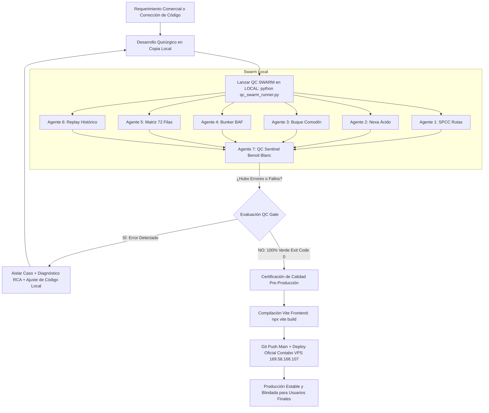

# 55. El QC SWARM en LOCAL: Arquitectura del Gemelo Digital y Enjambre Multi-Agente para Pruebas Pre-Producción de PETRAL ONE

**Fecha:** 26 de Octubre de 2026  
**Auditor Pericial & Arquitecto:** Benoit Blanc & Stack Master Geeksoft  
**Estado:** Especificación Maestra y Plan de Implementación Aprobado  
**Referencia & Benchmark:** `AI.TOOLS.FOR.GEEKSOFT\29 - CASH.PIT\12 - APP.Modularizada\10 - Agents.SWARM`  
**Entorno de Operación:** Local Sandbox (Digital Twin) ➔ Producción Oficial Contabo VPS (`169.58.168.107`)

---

## 🎙️ 1. Transcripción Oficial del Requerimiento (Whisper Forensic)

> *"Gemini, deseo hacer lo siguiente: dado que estamos en producción y cada modificación nueva que hago, a veces causa problemas a los usuarios como esta, necesito hacer lo siguiente:  
> Necesito que crees en local siempre un clon del estado actual del sistema, incluida sus bases de datos; crees como un ambiente virtual o lo que tú creas que es técnicamente más factible.  
> Luego vamos a crear un equipo de agentes —yo te voy a dar un ejemplo que lo que hagan es:  
> Primero, que no toquen los maestros. Los maestros son muy complejos de replicar.  
> Lo que quiero que hagan es que repliquen tanto las rutas grabadas en multicotizador, así como los escenarios de matriz financiera.  
> Entonces, que utilizando las herramientas del sistema, hagan todos los pasos que se tienen que hacer para recrear todo lo que los usuarios han hecho. Es decir, a través de los agentes rehacemos todo el trabajo que está en producción para ver si algo nos falla.  
> Entonces estamos en un loop donde hacemos una modificación al software en esa copia local, la probamos con los agentes y luego con ello qué logramos: que a la hora que subamos esas mejoras a producción, no tengamos estos problemas que estamos teniendo con los clientes, ¿me entiendes?  
> Entonces vamos a hacer un plan simpático para procesar eso."*

---

## 🏛️ 2. Diagnóstico del Dolor: De la Corrección Reactiva a la Inmunidad Agéntica

### 2.1. La Escena del Crimen Reciente (Caso 54 como Síntoma)
En el reciente caso de los 13,000 USD de la Matriz Financiera ([54_El_Caso_De_Los_13000_harcodeados.MAtriz.Fin.md](file:///c:/Users/rguti/PETRAL.SMART.DASHBOARD/Desarrollo.Profesional/Obsidian.Refactorizacion.Multicotizador/54_El_Caso_De_Los_13000_harcodeados.MAtriz.Fin.md)), el sistema colapsó en vivo con un `TypeError` cuando un usuario intentó por primera vez el **Flujo de Buque Comodín** (seleccionar una ruta diseñada con `MOQUEGUA` y cambiar en caliente el selector a `TABLONES`).
* Históricamente en septiembre 2026, los usuarios modelaban cotizaciones independientes para cada nave (`is_same_vessel = True`, Camino A de snapshots congelados).
* Ningún test manual detectó que el Camino B (`is_same_vessel = False`, recálculo dinámico de buque comodín) multiplicaba un string devuelto por la base de datos: `total_days * tce_req`.

### 2.2. La Solución Estructural: El Gemelo Digital Local con Swarm
No podemos depender de que los clientes descubran las fallas en producción.  
La solución consiste en establecer un **Entorno Clon Local (Digital Twin)** idéntico al VPS de Contabo, respaldado por un **Enjambre Multi-Agente Autónomo (QC Swarm)** que estresa y rehace automáticamente todo el trabajo comercial y operativo de los usuarios antes de autorizar cualquier despliegue a producción.

---

## 📐 3. Arquitectura del Sistema: Los 3 Planos del Swarm Petral

Inspirado en la arquitectura canónica probada en `CASH.PIT (10 - Agents.SWARM)`, adaptamos el modelo desacoplado en tres planos operativos:

```
┌──────────────────────────────────────────────────────────────────────────────────────────────────┐
│                                 PETRAL ONE LOCAL DIGITAL TWIN                                    │
├──────────────────────────────────────────────────────────────────────────────────────────────────┤
│                                                                                                  │
│   [AGENTE 1: SPCC CHARTERER]     [AGENTE 2: NEXA/MARCOBRE]      [AGENTE 3: WILDCARD ALLOCATOR]   │
│   Perfil: Rutas COA Mineras      Perfil: Rutas Cabotaje Ácido   Perfil: Buque Comodín (Camino B) │
│   Ilo - Matarani - Mejillones    Cajamarquilla - San Nicolás    Moquegua ➔ Tablones al vuelo     │
│            │                                  │                               │                  │
│            └──────────────────────────────────┼───────────────────────────────┘                  │
│                                               │                                                  │
│   [AGENTE 4: BUNKER/BAF STRESS]  [AGENTE 5: MATRIX BUILDER]     [AGENTE 6: REPLAYER HISTÓRICO]   │
│   Perfil: Variaciones IFO/MDO    Perfil: Proyecciones Mensuales Perfil: PB 2027 & 2028 +10%      │
│   Polinomio BAF & P_pond         72 Líneas / PnL / TCE Req      Replay y Comparación Snapshot    │
│            │                                  │                               │                  │
│   ═════════╧══════════════════════════════════╧═══════════════════════════════╧═══════════════   │
│                                               │                                                  │
│                                               ▼                                                  │
│         ╔═══════════════════════════════════════════════════════════════════════╗                │
│         ║             MOTOR DETERMINÍSTICO Y API LOCAL (FASTAPI :8000)          ║                │
│         ║      /api/v1/forecast/run  ·  /save  ·  /spot/calculate  ·  /load     ║                │
│         ╚═══════════════════════════════════════════════════════════════════════╝                │
│                                               ▲                                                  │
│                    ┌──────────────────────────┴──────────────────────────┐                       │
│                    │                                                     │                       │
│                    ▼                                                     ▼                       │
│         ┌─────────────────────────────────────┐         ┌──────────────────────────────────────┐ │
│         │     BASE DE DATOS LOCAL CLONADA     │         │      AGENTE 7: QC SENTINEL LOOPER    │ │
│         │ • Maestros Inmutables (Read-Only)   │◄───────►│             (BENOIT BLANC)           │ │
│         │ • Tablas Transaccionales Aisladas   │         │ • Observabilidad Full-Stack en Local │ │
│         │ • PostgreSQL Local / SQLite Mirror  │         │ • Cero Reseteo: Continúa Operando    │ │
│         └─────────────────────────────────────┘         │ • RCA & Generación de Parche K0      │ │
│                                                         │ • Gateway de Aprobación para Deploy  │ │
│                                                         └──────────────────────────────────────┘ │
└──────────────────────────────────────────────────────────────────────────────────────────────────┘
```

---

## 👥 4. Ficha Técnica de los 7 Agentes del Swarm Petral

| Agente | Nombre Operativo | Misión y Comportamiento | Frecuencia de Ejecución | Puntos Críticos Auditados |
| :--- | :--- | :--- | :--- | :--- |
| **Agente 1** | `⚓ SPCC Charterer` | Simula la creación y recálculo de viajes COA y Spot para SPCC (Ilo - Matarani - Mejillones), cargando parámetros de carga completa (13,500 TM). | Continuo (Ciclos de 10 cotizaciones) | Cálculo de flete por TM, demurrage contractual ($20,000/día), comisiones y márgenes brutos. |
| **Agente 2** | `🧪 Nexa Acid Operator` | Modela rutas complejas de cabotaje químico y ácido sulfúrico con múltiples tramos lastre y cargado entre San Nicolás, Cajamarquilla y puertos del norte. | Continuo (Ciclos de 8 tramos) | Distancias de red marítima, velocidades en lastre vs cargado, y costos de recalada portuaria. |
| **Agente 3** | `🃏 Wildcard Allocator` | **El Agente Comodín:** Toma sistemáticamente cotizaciones diseñadas para un buque (ej. `MOQUEGUA`) y las ejecuta en el endpoint de simulación asignando buques alternativos (`TABLONES`, `B/T CHINCHA`, etc.). | Estocástico / Alta Presión | Forzamiento del **Camino B** en `forecast_service.py`, validación de casteo de tipos numéricos (`tce_required`, consumos en puerto y mar). |
| **Agente 4** | `⛽ Bunker Stresstest` | Simula fluctuaciones agresivas en los precios de IFO 380 y MDO (±25%), forzando evaluaciones con precios ponderados de bootstrapping y verificación del polinomio BAF de SPCC. | Periódico (Por tanda de viajes) | Fórmulas BAF, consumos por tramo en mar y puerto, y no-colisión con cotizaciones congeladas. |
| **Agente 5** | `📊 Matrix Scenario Builder` | Construye matrices financieras completas de 72 líneas de proyección mensual para 2026, 2027 y 2028; ejecuta `/api/v1/forecast/run` y persiste mediante `/api/v1/forecast/save`. | Por lotes de proyección | Balance de flota, cálculo consolidado de PnL vs Required, TCE Real y persistencia JSON limpia con UUID. |
| **Agente 6** | `🕰️ Historical Replayer` | Lee los escenarios históricos reales guardados en producción (`PB 2027` y `2028 +10%`), los re-ejecuta desde cero y compara los resultados numéricos contra los snapshots grabados. | Verificación de No-Regresión | Discrepancia = 0.00% frente a la historia contable oficial de Petral. |
| **Agente 7** | `🕵️ QC Sentinel & Looper (Benoit Blanc)` | **Auditor Omnipresente:** Captura excepciones HTTP 500/422, detecta advertencias en logs, analiza invariantes matemáticos y documenta el diagnóstico pericial (RCA). | 100% del Tiempo (Supervisor) | **Mandato de Cero Reseteo:** Un error aísla el caso, pero no congela a los demás agentes. Emite el dictamen de pase a producción. |

---

## 🛡️ 5. Principio Sagrado: Maestros Inmutables (Ground Truth Canónico)

Tal como instruye la gerencia:
> *"Primero que no toquen los maestros, los maestros son muy complejos de replicar."*

### 5.1. Definición de Tablas Maestras (Read-Only)
Las siguientes entidades constituyen el **Maestro de Verdad Canónica** y NUNCA son modificadas por los agentes del Swarm:
1. `vessels` (Ficha técnica naval, consumos IFO/MDO, velocidad, eslora, manga, DWT, DWCC, TCE Requerido).
2. `ports` (Catálogo de puertos marítimos nacionales e internacionales).
3. `distances` (Matriz determinística de distancias náuticas entre puertos).
4. `port_cost_tariffs` y `port_cost_rules` (Tarifas y fórmulas de costos portuarios).
5. `clients` (Maestro de clientes corporativos: SPCC, NEXA, MARCOBRE, etc.).
6. `bunker_invoices` y `bunker_bunkering_events` (Histórico de tanqueadas y precios ponderados).

### 5.2. Espacio de Trabajo Transaccional del Swarm
Los agentes operan **únicamente** sobre las capas de simulación y proyección:
* `routes_quotes` (en sandbox local).
* `commercial_forecasts` (en sandbox local).
* Memoria en caliente y payloads de simulación del endpoint `/forecast/run`.

---

## ⚙️ 6. Arquitectura Técnica del Gemelo Digital Local

Para que el Swarm sea 100% autónomo, reproducible y seguro, el entorno local cuenta con 3 componentes fundamentales:

### 6.1. Script de Ingesta y Clonación: `sync_prod_masters_to_local.py`
* Conecta por SSH/PostgreSQL al VPS Contabo (`169.58.168.107`).
* Extrae un dump atómico en formato JSON/SQL de las tablas maestras (`vessels`, `ports`, `distances`, etc.) y de los escenarios históricos de `commercial_forecasts`.
* Levanta o actualiza la base de datos local (PostgreSQL local o SQLite Mirror de alta fidelidad).

### 6.2. Motor Local en Ejecución
* **Backend:** FastAPI corriendo localmente (`http://localhost:8000`) apuntando a la base de datos local clonada.
* **Frontend (Opcional para inspección visual):** Vite dev server en `http://localhost:5173`.

### 6.3. Orquestador del Swarm: `qc_swarm_runner.py`
Un script en Python puro (sin dependencias pesadas ni necesidad de abrir navegadores) que:
1. Instancia concurrentemente a los 6 Agentes usando `asyncio` o `threading`.
2. Simula el flujo continuo de trabajo de los usuarios recreando 50+ viajes y 5+ escenarios completos en < 30 segundos.
3. El **Agente 7 (QC Sentinel)** intercepta cualquier código HTTP diferente de 200, cualquier discrepancia numérica o warning de tipos, y genera un reporte de telemetría forense.

---

## 🔄 7. El Loop de Desarrollo y Despliegue Seguro (Local-to-Prod Pipeline)

El nuevo flujo operativo que protege la producción de Petral funciona así:



---

## 📋 8. Matriz de Invariantes Numéricos y Reglas de Calidad (ABIDE QC Gate)

El Agente 7 audita en tiempo real que cada cálculo cumpla rigurosamente con los siguientes invariantes:

1. **Invariante PnL vs TCE Requerido:**
   $$\text{PL\_vs\_Required} = \text{Voyage\_Result} - (\text{Total\_Duration} \times \text{TCE\_Required})$$
   *Tolerancia máxima de redondeo:* $\pm 0.05 \text{ USD}$.
2. **Invariante de Duración Náutica:**
   $$\text{Total\_Duration} = \text{Sea\_Days} + \text{Port\_Days} + \text{Demurrage\_Days}$$
   *Ningún viaje puede tener duración menor o igual a cero.*
3. **Invariante de Tipos Numéricos (Anti-String):**
   *Cualquier valor numérico (`tce_required`, `consumption`, `speed`, `dwt`, `grt`) DEBE ser de tipo `float` o `int`. Si el backend recibe o procesa un `str` en una operación aritmética, el Sentinel marca violación crítica nivel 1.*
4. **Invariante de Continuidad (Cero Reseteo):**
   *Si el Agente 3 (Comodín) genera una combinación inválida de puerto o buque, la API debe responder con un error HTTP controlado (422 o 400 descriptivo), pero NUNCA un HTTP 500 no capturado que tire el servidor.*

---

## 🚀 9. Plan de Implementación por Fases

| Fase | Hito / Entregable | Herramientas / Archivos |
| :---: | :--- | :--- |
| **Fase 1** | **Extractor y Clonador de Base de Datos Local** | Crear `scratch/sync_prod_masters_to_local.py` que descargue un snapshot de los maestros y cotizaciones desde Contabo a un almacenamiento local aislado. |
| **Fase 2** | **Construcción del Motor de Pruebas del Swarm** | Desarrollar `scratch/qc_swarm/` con los contratos de datos y la implementación modular de los 6 Agentes de negocio + Agente 7 QC Sentinel. |
| **Fase 3** | **Batería de Pruebas de Estrés de la Matriz Financiera** | Incorporar la recreación de los escenarios históricos `PB 2027` y `2028 +10%` y el caso de buques comodín `MOQUEGUA ➔ TABLONES`. |
| **Fase 4** | **Certificación y Pipeline de Deploy Local-to-Prod** | Configurar el runner ejecutable en terminal (`python run_qc_swarm.py`) que sirva de semáforo verde indispensable antes de ejecutar `deploy_petral_one_contabo.py`. |

---

## 📌 10. Conclusión del Dictamen Pericial

El **QC SWARM en LOCAL** institucionaliza una barrera de contención impenetrable:
* Recrea el comportamiento real de los clientes de Petral en segundos.
* Preserva los Maestros Navales como verdad canónica sagrada.
* Descubre casos borde (como el buque comodín o descalces de tipos) en la máquina del desarrollador y no en los monitores de la gerencia comercial.
* Garantiza que cada deploy al VPS Contabo sea un evento de riesgo cero.
